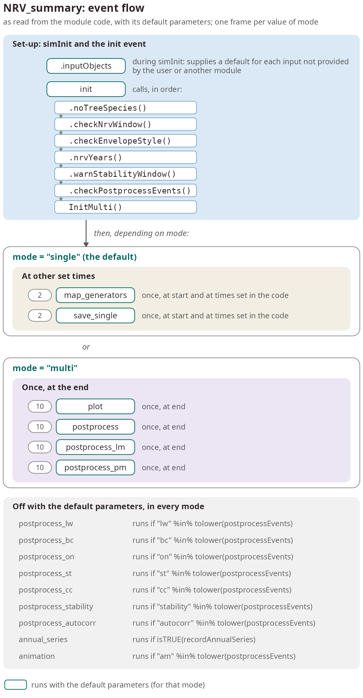
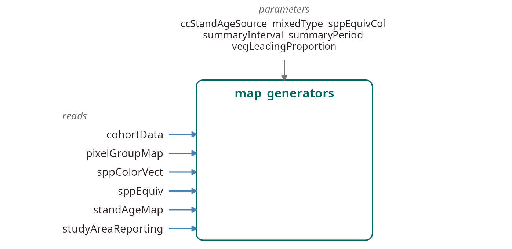

# NRV_summary Module

<!-- the following are text references used in captions for LaTeX compatibility -->
(ref:NRV-summary) *NRV_summary*

<!-- if knitting to pdf remember to add the pandoc_args: ["--extract-media", "."] option to yml in order to get the badge images -->

#### Authors:

Alex M. Chubaty <achubaty@for-cast.ca> [aut]
<!-- ideally separate authors with new lines, '\n' not working -->

## Module Overview

### Module summary

NRV simulation post-processing and summary creation.
Produces 'X over time' and other summaries for multiple landscape and patch metrics.

### Module inputs and parameters

Table \@ref(tab:moduleInputs-NRV-summary) shows the full list of module inputs.

<table class="table" style="margin-left: auto; margin-right: auto;">
<caption>(\#tab:moduleInputs-NRV-summary)(\#tab:moduleInputs-NRV-summary)List of (ref:NRV-summary) input objects and their description.</caption>
 <thead>
  <tr>
   <th style="text-align:left;"> objectName </th>
   <th style="text-align:left;"> objectClass </th>
   <th style="text-align:left;"> desc </th>
   <th style="text-align:left;"> sourceURL </th>
  </tr>
 </thead>
<tbody>
  <tr>
   <td style="text-align:left;"> cohortData </td>
   <td style="text-align:left;"> data.table </td>
   <td style="text-align:left;"> Required in single mode. </td>
   <td style="text-align:left;"> NA </td>
  </tr>
  <tr>
   <td style="text-align:left;"> LandTypeCC_reporting </td>
   <td style="text-align:left;"> SpatRaster </td>
   <td style="text-align:left;"> Current-conditions land cover (Canada LCC 2020) with urban RETAINED. Used to correct the year-0 current-condition snapshot: the simulation imputes urban to its nearest forest type (pre-industrial state), so the year-0 rasters would otherwise report imputed forest as real current forest. Only urban differs between the sim and reporting layers -- water/barren/snow are already NA on both sides. </td>
   <td style="text-align:left;"> NA </td>
  </tr>
  <tr>
   <td style="text-align:left;"> flammableMap </td>
   <td style="text-align:left;"> SpatRaster </td>
   <td style="text-align:left;"> binary flammability map (required with `type = 'single'`) </td>
   <td style="text-align:left;"> NA </td>
  </tr>
  <tr>
   <td style="text-align:left;"> outputsDF </td>
   <td style="text-align:left;"> data.frame </td>
   <td style="text-align:left;"> (mode = 'multi', optional) the files the replicate simulations saved, with at least a `file` column (e.g. their `outputs(sim)` row-bound). When absent, the replicate folders under `outputPath(sim)` are listed. </td>
   <td style="text-align:left;"> NA </td>
  </tr>
  <tr>
   <td style="text-align:left;"> pixelGroupMap </td>
   <td style="text-align:left;"> SpatRaster </td>
   <td style="text-align:left;"> Required in single mode. </td>
   <td style="text-align:left;"> NA </td>
  </tr>
  <tr>
   <td style="text-align:left;"> reportingPolygons </td>
   <td style="text-align:left;"> list </td>
   <td style="text-align:left;"> reporting polygons for post-processing (required with `type = 'multi'`) </td>
   <td style="text-align:left;"> NA </td>
  </tr>
  <tr>
   <td style="text-align:left;"> speciesLayers </td>
   <td style="text-align:left;"> SpatRaster </td>
   <td style="text-align:left;"> initial percent cover raster layers used for simulation. </td>
   <td style="text-align:left;"> NA </td>
  </tr>
  <tr>
   <td style="text-align:left;"> sppColorVect </td>
   <td style="text-align:left;"> character </td>
   <td style="text-align:left;"> A named vector of colors to use for plotting. The names must be in `sim$sppEquiv[[P(sim)$sppEquivCol]]`, and should also contain a color for 'Mixed' </td>
   <td style="text-align:left;"> NA </td>
  </tr>
  <tr>
   <td style="text-align:left;"> sppColorVectReporting </td>
   <td style="text-align:left;"> character </td>
   <td style="text-align:left;"> (mode = 'multi', with `sppEquivColReporting`) named colours for the reporting groups and 'Mixed'. If absent, `LandR::sppColors()` on the reporting column. </td>
   <td style="text-align:left;"> NA </td>
  </tr>
  <tr>
   <td style="text-align:left;"> sppEquiv </td>
   <td style="text-align:left;"> data.table </td>
   <td style="text-align:left;"> table of species equivalencies. See `LandR::sppEquivalencies_CA`.NANA </td>
   <td style="text-align:left;"> NA </td>
  </tr>
  <tr>
   <td style="text-align:left;"> standAgeMap </td>
   <td style="text-align:left;"> SpatRaster </td>
   <td style="text-align:left;"> (mode = 'single') stand age of the current forest (e.g. Biomass_borealDataPrep's), on the grid of `pixelGroupMap` or on a larger grid aligned with it. The year-0 stand-age map, with `ccStandAgeSource = 'standAgeMap'`. </td>
   <td style="text-align:left;"> NA </td>
  </tr>
  <tr>
   <td style="text-align:left;"> studyAreaReporting </td>
   <td style="text-align:left;"> SpatVector </td>
   <td style="text-align:left;"> Required in single mode. </td>
   <td style="text-align:left;"> NA </td>
  </tr>
</tbody>
</table>

Summary of user-visible parameters (Table \@ref(tab:moduleParams-NRV-summary)).

<table class="table" style="margin-left: auto; margin-right: auto;">
<caption>(\#tab:moduleParams-NRV-summary)(\#tab:moduleParams-NRV-summary)List of (ref:NRV-summary) parameters and their description.</caption>
 <thead>
  <tr>
   <th style="text-align:left;"> paramName </th>
   <th style="text-align:left;"> paramClass </th>
   <th style="text-align:left;"> default </th>
   <th style="text-align:left;"> min </th>
   <th style="text-align:left;"> max </th>
   <th style="text-align:left;"> paramDesc </th>
   <th style="text-align:left;"> cacheKey </th>
  </tr>
 </thead>
<tbody>
  <tr>
   <td style="text-align:left;"> autocorrMaxLag </td>
   <td style="text-align:left;"> integer </td>
   <td style="text-align:left;"> 200 </td>
   <td style="text-align:left;"> 1 </td>
   <td style="text-align:left;"> NA </td>
   <td style="text-align:left;"> (mode = 'multi') longest lag (years) of the autocorrelation of the annual landscape series (the `autocorr` event). The longest lag used is the largest of this, `summaryInterval` and 50, cut to the number of NRV years less one when the series is shorter. </td>
   <td style="text-align:left;"> TRUE </td>
  </tr>
  <tr>
   <td style="text-align:left;"> ageClasses </td>
   <td style="text-align:left;"> character </td>
   <td style="text-align:left;"> Young, I.... </td>
   <td style="text-align:left;"> NA </td>
   <td style="text-align:left;"> NA </td>
   <td style="text-align:left;"> descriptions/labels for age classes (seral stages) </td>
   <td style="text-align:left;"> TRUE </td>
  </tr>
  <tr>
   <td style="text-align:left;"> ageClassCutOffs </td>
   <td style="text-align:left;"> integer </td>
   <td style="text-align:left;"> 0, 40, 8.... </td>
   <td style="text-align:left;"> NA </td>
   <td style="text-align:left;"> NA </td>
   <td style="text-align:left;"> defines the age boundaries between age classes </td>
   <td style="text-align:left;"> TRUE </td>
  </tr>
  <tr>
   <td style="text-align:left;"> ageClassMaxAge </td>
   <td style="text-align:left;"> integer </td>
   <td style="text-align:left;"> 400 </td>
   <td style="text-align:left;"> NA </td>
   <td style="text-align:left;"> NA </td>
   <td style="text-align:left;"> maximum possible age </td>
   <td style="text-align:left;"> TRUE </td>
  </tr>
  <tr>
   <td style="text-align:left;"> ccStandAgeSource </td>
   <td style="text-align:left;"> character </td>
   <td style="text-align:left;"> standAgeMap </td>
   <td style="text-align:left;"> NA </td>
   <td style="text-align:left;"> NA </td>
   <td style="text-align:left;"> (mode = 'single') where the current condition's (year 0's) stand-age map comes from: 'standAgeMap', the age layer `sim$standAgeMap` (e.g. Biomass_borealDataPrep's) on the pixels with cohorts, rounded and then floored to the decade, as `LandR::standAgeMapGenerator()` floors the simulated years' ages; or 'cohortData', that generator's biomass-weighted age of the year-0 cohorts, which keeps the binning of the cohort ages. 'standAgeMap' warns and uses the cohorts when `sim$standAgeMap` is absent or not on a grid aligned with `pixelGroupMap`. The simulated years always come from the cohorts. </td>
   <td style="text-align:left;"> TRUE </td>
  </tr>
  <tr>
   <td style="text-align:left;"> patchDirections </td>
   <td style="text-align:left;"> integer </td>
   <td style="text-align:left;"> 4 </td>
   <td style="text-align:left;"> 4 </td>
   <td style="text-align:left;"> 8 </td>
   <td style="text-align:left;"> patch connectivity for the 'lw' (LandWeb summary) large-patch analysis, passed to `nrvtools::largePatchCounts()` (via `landscapemetrics::get_patches`): `4` = rook / 4-connected (matches v2's GDAL `polygonize`; the default), `8` = queen / 8-connected. NOTE: v2 was fixed at 4-connectivity; exposing 8 (queen) is a departure from v2. </td>
   <td style="text-align:left;"> TRUE </td>
  </tr>
  <tr>
   <td style="text-align:left;"> mixedType </td>
   <td style="text-align:left;"> integer </td>
   <td style="text-align:left;"> 2 </td>
   <td style="text-align:left;"> NA </td>
   <td style="text-align:left;"> NA </td>
   <td style="text-align:left;"> How to define mixed stands: `0L` for none; `1L` for any species admixture; `2L` for deciduous &gt; conifer. See `LandR::vegTypeMapGenerator`. </td>
   <td style="text-align:left;"> TRUE </td>
  </tr>
  <tr>
   <td style="text-align:left;"> mode </td>
   <td style="text-align:left;"> character </td>
   <td style="text-align:left;"> single </td>
   <td style="text-align:left;"> NA </td>
   <td style="text-align:left;"> NA </td>
   <td style="text-align:left;"> use 'single' to run part of a simulation; use 'multi' to run as part of postprocessing multiple runs. </td>
   <td style="text-align:left;"> TRUE </td>
  </tr>
  <tr>
   <td style="text-align:left;"> nrvWindow </td>
   <td style="text-align:left;"> numeric </td>
   <td style="text-align:left;"> 1 </td>
   <td style="text-align:left;"> 0 </td>
   <td style="text-align:left;"> 1 </td>
   <td style="text-align:left;"> the NRV is the last fraction of `summaryPeriod` (1, the default, is all of it; 0.3 is the last 30%: with the default `summaryPeriod`, years 910-1000). Must be above 0 and at most 1. The LandWeb summaries (lw) and the per-class patch metric pages (pm) pool only the summary times in it, and the envelope figures shade it; their time series still show all of `summaryPeriod`. </td>
   <td style="text-align:left;"> TRUE </td>
  </tr>
  <tr>
   <td style="text-align:left;"> recordAnnualSeries </td>
   <td style="text-align:left;"> logical </td>
   <td style="text-align:left;"> FALSE </td>
   <td style="text-align:left;"> NA </td>
   <td style="text-align:left;"> NA </td>
   <td style="text-align:left;"> (mode = 'single') record a few landscape scalars every year (proportion young and old, mean stand age, total biomass, proportion by leading species) in `annualSeries.csv`. Off by default: it adds an event per simulated year to each replicate. The `autocorr` event of 'multi' mode reads these files to give the autocorrelation time of the landscape, hence how far apart the summary snapshots must be to be independent. </td>
   <td style="text-align:left;"> TRUE </td>
  </tr>
  <tr>
   <td style="text-align:left;"> reuseAggregates </td>
   <td style="text-align:left;"> logical </td>
   <td style="text-align:left;"> FALSE </td>
   <td style="text-align:left;"> NA </td>
   <td style="text-align:left;"> NA </td>
   <td style="text-align:left;"> (mode = 'multi') if TRUE, reuse a complete per-replicate `_aggregates` parquet dataset instead of recomputing it, re-summarizing the surviving parquets to regenerate the envelopes/CSVs/figures. Use to iterate on the plots/CSVs without re-running the (~hours) landscape-metric aggregation; leave FALSE for a fresh run. </td>
   <td style="text-align:left;"> TRUE </td>
  </tr>
  <tr>
   <td style="text-align:left;"> envelopeStyle </td>
   <td style="text-align:left;"> character </td>
   <td style="text-align:left;"> ribbon </td>
   <td style="text-align:left;"> NA </td>
   <td style="text-align:left;"> NA </td>
   <td style="text-align:left;"> (mode = 'multi') how the lm and pm envelope figures show the replicates: `"ribbon"` (default) draws the range of the replicates as a band around their mean; `"lines"` draws one thin grey line per replicate under a bold line for their median (`nrvtools::plot_nrv_envelope(type = "lines")`). The files keep their names (`&lt;subregion&gt; &lt;metric&gt;_ribbon.png`, `&lt;metric&gt;_ribbon_p&lt;N&gt;.png`). The replicate values are read once per reporting layer; a layer whose aggregates hold none gets ribbons, and a message says so. The boxplot figures and the per-class pages are the same in both styles. </td>
   <td style="text-align:left;"> TRUE </td>
  </tr>
  <tr>
   <td style="text-align:left;"> plotWorkers </td>
   <td style="text-align:left;"> integer </td>
   <td style="text-align:left;"> 8 </td>
   <td style="text-align:left;"> 1 </td>
   <td style="text-align:left;"> NA </td>
   <td style="text-align:left;"> (mode = 'multi') hard cap on the number of local worker processes used to render the postprocess figures in parallel (each figure is an independent `ggsave`). The actual count is RAM-aware (`pemisc::optimalClusterNum`) but never exceeds this cap, so a shared compute node is not swamped; 1 renders sequentially. Uses `future` multisession (not fork; the crew worker is a mirai daemon). </td>
   <td style="text-align:left;"> TRUE </td>
  </tr>
  <tr>
   <td style="text-align:left;"> postprocessEvents </td>
   <td style="text-align:left;"> character </td>
   <td style="text-align:left;"> lm, pm </td>
   <td style="text-align:left;"> NA </td>
   <td style="text-align:left;"> NA </td>
   <td style="text-align:left;"> Specify which subset of postprocessing events to run. At least one of: 'am' for the stand-age time-series animation (GIF); 'bc' for BC seral stage patch metrics; 'lm' for default landscape metrics; 'lw' for default LandWeb summaries 'pm' for default patch metrics; 'on' for ON patch metrics; 'st' for stand-level measures (age-class, leading-type and forested shares, total biomass) at each summary time, from the saved snapshots (`st.csv`, `st_CC.csv`, `st_nrvComparison.csv`) and their figures; with 'stability' in the same run they are tested too. With 'lm' in the same run, also the NRV comparison tables, `csv/lm/&lt;layer&gt;/lm_nrvComparison.csv`, which say where the current condition falls against the NRV range. Not in the default: it runs only when asked for. 'cc' for one figure per reporting layer and unit with the lm and st metrics against the NRV (`figures/all/&lt;layer&gt;/&lt;unit&gt;.png`), with 'lm' or 'st' in the same run: it draws the comparisons those events record. The stand-level rows go on the figure of every unit named like the study area (`.studyAreaName`); with no such unit they have a figure of their own, `figures/all/&lt;studyArea&gt;/&lt;studyArea&gt;.png`. With 'cc' in the run, the 'lm' event also writes the NRV comparison tables. Not in the default: it runs only when asked for. 'autocorr' for the autocorrelation time of the annual landscape series (`annualSeries.csv`, from `recordAnnualSeries = TRUE`), the correlation between snapshots `summaryInterval` years apart and a recommended thinning interval; `autocorrelation.csv` and its figure. Not in the default: it runs only when asked for. 'stability' for the check that the run is long enough (is each metric still trending over the end of the NRV period?), `stability.csv` and its figures, and, with 'lm' in the same run, the current-condition overview of each lm layer. Not in the default: it runs only when asked for. Any other value is an error ('fd', forest degradation indicators, is not implemented). </td>
   <td style="text-align:left;"> TRUE </td>
  </tr>
  <tr>
   <td style="text-align:left;"> stabilityAlpha </td>
   <td style="text-align:left;"> numeric </td>
   <td style="text-align:left;"> 0.05 </td>
   <td style="text-align:left;"> 0 </td>
   <td style="text-align:left;"> 1 </td>
   <td style="text-align:left;"> (mode = 'multi') significance level of the Mann-Kendall trend test in the stability check (the `stability` event). </td>
   <td style="text-align:left;"> TRUE </td>
  </tr>
  <tr>
   <td style="text-align:left;"> stabilityMinChange </td>
   <td style="text-align:left;"> numeric </td>
   <td style="text-align:left;"> 0.1 </td>
   <td style="text-align:left;"> 0 </td>
   <td style="text-align:left;"> 1 </td>
   <td style="text-align:left;"> (mode = 'multi') a series is flagged 'still changing' only if its fitted change across the stability window exceeds this fraction of the series' range (its largest minus smallest value over all reps within the window), as well as being a significant trend. </td>
   <td style="text-align:left;"> TRUE </td>
  </tr>
  <tr>
   <td style="text-align:left;"> stabilityWindow </td>
   <td style="text-align:left;"> numeric </td>
   <td style="text-align:left;"> 0.5 </td>
   <td style="text-align:left;"> 0 </td>
   <td style="text-align:left;"> 1 </td>
   <td style="text-align:left;"> (mode = 'multi') the last fraction of the NRV period (`summaryPeriod` when `nrvWindow` is 1) over which the stability check looks for a directional trend (0.5 = the last half). A run whose metrics are still trending there needs to be longer. It does not define the NRV (see `nrvWindow`). </td>
   <td style="text-align:left;"> TRUE </td>
  </tr>
  <tr>
   <td style="text-align:left;"> reps </td>
   <td style="text-align:left;"> integer </td>
   <td style="text-align:left;"> 1, 2, 3,.... </td>
   <td style="text-align:left;"> 1 </td>
   <td style="text-align:left;"> NA </td>
   <td style="text-align:left;"> number of replicates/runs per study area. </td>
   <td style="text-align:left;"> TRUE </td>
  </tr>
  <tr>
   <td style="text-align:left;"> sieveThresh </td>
   <td style="text-align:left;"> integer </td>
   <td style="text-align:left;"> 1 </td>
   <td style="text-align:left;"> NA </td>
   <td style="text-align:left;"> NA </td>
   <td style="text-align:left;"> threshold patch size (number of pixels) to use with `terra::sieve` when creating seral stage maps </td>
   <td style="text-align:left;"> TRUE </td>
  </tr>
  <tr>
   <td style="text-align:left;"> simTimes </td>
   <td style="text-align:left;"> numeric </td>
   <td style="text-align:left;"> NA, NA </td>
   <td style="text-align:left;"> NA </td>
   <td style="text-align:left;"> NA </td>
   <td style="text-align:left;"> Simulation start and end times when running in 'multi' mode. </td>
   <td style="text-align:left;"> TRUE </td>
  </tr>
  <tr>
   <td style="text-align:left;"> sppEquivCol </td>
   <td style="text-align:left;"> character </td>
   <td style="text-align:left;"> LandR </td>
   <td style="text-align:left;"> NA </td>
   <td style="text-align:left;"> NA </td>
   <td style="text-align:left;"> The column in `sim$sppEquiv` data.table to use as a naming convention </td>
   <td style="text-align:left;"> TRUE </td>
  </tr>
  <tr>
   <td style="text-align:left;"> sppEquivColReporting </td>
   <td style="text-align:left;"> character </td>
   <td style="text-align:left;"> NA </td>
   <td style="text-align:left;"> NA </td>
   <td style="text-align:left;"> NA </td>
   <td style="text-align:left;"> (mode = 'multi') column of `sim$sppEquiv` that groups the simulated species (`sppEquivCol`) for reporting. When set, the vegetation-type maps that the 'lm', 'lw' and 'pm' analyses read, for the simulated years and for current conditions, are rebuilt from the saved `cohortData` and `pixelGroupMap` with each species recoded to its group, so biomass is summed within a group before the leading type is decided. `LandR::vegTypeMapGenerator()` sums only within a code, so relabelling the species-level maps would not give this. `NA` (the default) analyses the species-level maps the simulation saved. </td>
   <td style="text-align:left;"> TRUE </td>
  </tr>
  <tr>
   <td style="text-align:left;"> summaryInterval </td>
   <td style="text-align:left;"> integer </td>
   <td style="text-align:left;"> 100 </td>
   <td style="text-align:left;"> NA </td>
   <td style="text-align:left;"> NA </td>
   <td style="text-align:left;"> simulation time interval at which to take 'snapshots' used for summary analyses. </td>
   <td style="text-align:left;"> TRUE </td>
  </tr>
  <tr>
   <td style="text-align:left;"> summaryPeriod </td>
   <td style="text-align:left;"> integer </td>
   <td style="text-align:left;"> 700, 1000 </td>
   <td style="text-align:left;"> NA </td>
   <td style="text-align:left;"> NA </td>
   <td style="text-align:left;"> lower and upper end of the range of simulation times used for summary analyses. </td>
   <td style="text-align:left;"> TRUE </td>
  </tr>
  <tr>
   <td style="text-align:left;"> timeSeriesTimes </td>
   <td style="text-align:left;"> numeric </td>
   <td style="text-align:left;"> 0, 1, 2,.... </td>
   <td style="text-align:left;"> NA </td>
   <td style="text-align:left;"> NA </td>
   <td style="text-align:left;"> simulation times for which to build time series animations; the default is start + 601:650 when the run is that long, otherwise the last 50 years of the run. </td>
   <td style="text-align:left;"> TRUE </td>
  </tr>
  <tr>
   <td style="text-align:left;"> vegLeadingProportion </td>
   <td style="text-align:left;"> numeric </td>
   <td style="text-align:left;"> 0.75 </td>
   <td style="text-align:left;"> 0 </td>
   <td style="text-align:left;"> 1 </td>
   <td style="text-align:left;"> A number that defines whether a species is leading for a given pixel. Default: `LandR::leadingSpeciesProp()`, i.e. option `LandR.leadingSpeciesProp`, which takes `LandR.mixedwoodProp` (0.75) unless set. Setting it in one place moves every module and LandR function together. </td>
   <td style="text-align:left;"> TRUE </td>
  </tr>
  <tr>
   <td style="text-align:left;"> .plots </td>
   <td style="text-align:left;"> character </td>
   <td style="text-align:left;"> screen </td>
   <td style="text-align:left;"> NA </td>
   <td style="text-align:left;"> NA </td>
   <td style="text-align:left;"> Used by `SpaDES.core::Plots`, which can be optionally used here. </td>
   <td style="text-align:left;"> TRUE </td>
  </tr>
  <tr>
   <td style="text-align:left;"> .plotInitialTime </td>
   <td style="text-align:left;"> numeric </td>
   <td style="text-align:left;"> 0 </td>
   <td style="text-align:left;"> NA </td>
   <td style="text-align:left;"> NA </td>
   <td style="text-align:left;"> Describes the simulation time at which the first plot event should occur. </td>
   <td style="text-align:left;"> TRUE </td>
  </tr>
  <tr>
   <td style="text-align:left;"> .plotInterval </td>
   <td style="text-align:left;"> numeric </td>
   <td style="text-align:left;"> NA </td>
   <td style="text-align:left;"> NA </td>
   <td style="text-align:left;"> NA </td>
   <td style="text-align:left;"> Describes the simulation time interval between plot events. </td>
   <td style="text-align:left;"> TRUE </td>
  </tr>
  <tr>
   <td style="text-align:left;"> .studyAreaName </td>
   <td style="text-align:left;"> character </td>
   <td style="text-align:left;"> NA </td>
   <td style="text-align:left;"> NA </td>
   <td style="text-align:left;"> NA </td>
   <td style="text-align:left;"> Human-readable name for the study area used, or a hash of the study area obtained using `reproducible::studyAreaName()`. </td>
   <td style="text-align:left;"> TRUE </td>
  </tr>
  <tr>
   <td style="text-align:left;"> .seed </td>
   <td style="text-align:left;"> list </td>
   <td style="text-align:left;">  </td>
   <td style="text-align:left;"> NA </td>
   <td style="text-align:left;"> NA </td>
   <td style="text-align:left;"> Named list of seeds to use for each event (names). </td>
   <td style="text-align:left;"> TRUE </td>
  </tr>
  <tr>
   <td style="text-align:left;"> .useCache </td>
   <td style="text-align:left;"> logical </td>
   <td style="text-align:left;"> FALSE </td>
   <td style="text-align:left;"> NA </td>
   <td style="text-align:left;"> NA </td>
   <td style="text-align:left;"> Should caching of events or module be used? </td>
   <td style="text-align:left;"> TRUE </td>
  </tr>
</tbody>
</table>

### Reporting by groups of the simulated species

When species are simulated separately but reported by groups of them, set `sppEquivColReporting`
to the column of `sim$sppEquiv` that holds the groups (LandWeb uses `"LandWebReport"`, its
reporting groups). In `mode = "multi"`, the vegetation-type maps that the `lm`, `lw` and `pm`
analyses read, for the simulated years and for current conditions, are then rebuilt from the saved
`cohortData` and `pixelGroupMap` with each species recoded to its group, and written under
`postprocess/_reportingMaps/`. Biomass is summed within a group before the leading type is decided.
`LandR::vegTypeMapGenerator()` sums biomass only within a species code, so relabelling the
species-level maps would not give the same result: a stand of 40% black spruce, 40% tamarack and
20% aspen is led by the group holding both conifers.

A simulated code in two groups, or a group holding both conifers and broadleaves, stops the run.
The groups' colours come from the optional input `sppColorVectReporting`. With
`sppEquivColReporting = NA` (the default), the analyses read the species-level maps the simulation
saved.

### Events

In `mode = "multi"` the postprocessing events selected via the `postprocessEvents`
parameter run at the end of the simulation. Alongside the metric events (`lm`, `pm`,
`lw`, `bc`, ...), `"am"` produces a **stand-age time-series animation**: replicate 1's
saved `standAgeMap` layers for the `timeSeriesTimes` years are reclassified into age
classes (`ageClassCutOffs` / `ageClasses`, coloured young &rarr; old with `RdYlGn`) and
written to `standAge_animation.gif` under the module's figure path.

The animation is encoded with **`gifski`** (a pure-Rust GIF encoder bundled as an R
package), which needs no external tools. This deliberately avoids ImageMagick: the v2
`animation::saveGIF` path routinely failed with *"cache resources exhausted"* and required
raising ImageMagick's `policy.xml` memory/disk limits (see
[LandWeb #153](https://github.com/PredictiveEcology/LandWeb/issues/153)). With `gifski`
**no such system configuration is required**.

Two more events are opt-in (not in the default `postprocessEvents`), and both read the
current condition and the NRV range of each metric.
`"st"` takes the stand-level measures from the replicates' saved snapshots at each summary time:
the share of the forest in each age class, the forested share of the area, the share of the area
led by each type (the mixed class included) and the total biomass (forested cells only).
It writes `csv/st/<studyArea>/st.csv`, `st_CC.csv` (the current condition) and
`st_nrvComparison.csv` (whether the current condition is inside, above or below the NRV range),
and its figures (see *Plotting*).
With `"lm"` in the same run, `csv/lm/<layer>/lm_nrvComparison.csv` is written as well, from the
landscape-level rows, and with `"stability"` the stand series are tested too.
`"cc"` draws, for each reporting layer and unit, one figure with the current condition of the lm
metrics and the stand-level (st) measures against their NRV ranges (the pm, lw and bc metrics are
not on it), from the comparisons the `lm` and `st` events record (it needs one of them in the run).
It runs after them and before the `plot` event.

The autocorrelation check is opt-in in two parts. In `mode = "single"`,
`recordAnnualSeries = TRUE` adds an `annual_series` event for every simulated year (about a
thousand events per replicate) that writes `annualSeries.csv` beside the replicate's other
outputs, one row per year with no rasters made, for the reporting area (`studyAreaReporting`):
`time`; `propYoung`, the proportion of the forest younger than the first cut-off above the
youngest (40 years with the default `ageClassCutOffs`, `c(0, 40, 80, 120)`); `propOld`, the
proportion at or above the last cut-off (120 years); `meanStandAge`; `totalBiomassTg`, the total biomass in teragrams;
and a `lead_<species>` column, the proportion of the forest led by each species (`lead_Mixed`
for mixed stands). It is `FALSE` by default.
In `mode = "multi"`, `"autocorr"` in `postprocessEvents` (not in the default) runs the
`postprocess_autocorr` event, which reads the `annualSeries.csv` files found in the replicate
folders (so a file left by an earlier run with `recordAnnualSeries = TRUE` is analysed if the
folder was not cleared) and, over the NRV years, takes the autocorrelation of each series.
The replicates are treated as realisations of one process: each series is centred on the mean
of all replicates and NRV years, and the variance is pooled over the replicates.
The autocorrelation time of a series is that of an exponential decay with the mean lag-1
autocorrelation as its rate, `tau = (1 + phi) / (1 - phi)`; no curve is fitted, and `ar1Misfit`
says how far the autocorrelation at lags 1 to 50 departs from that decay.
The recommended thinning is the largest `tau`.
If the replicates' means differ, the common mean counts that difference as autocorrelation,
which errs toward more thinning.
The estimates are lower bounds: a short series biases the sample autocorrelation toward 0,
and the event says so when the NRV has fewer than 20 times the recommended thinning in years.
The longest lag is the largest of `autocorrMaxLag` (200 years), `summaryInterval` and 50, cut to
the number of NRV years less one when the series is shorter (the correlation at `summaryInterval`
is then not estimated, and the message says so).
A replicate whose file does not cover the NRV years is left out with a warning, and a series
that is missing from a replicate's file is left out with a message.
`csv/autocorrelation/autocorrelation.csv` has one row per series: `phi`, `tau`, `ar1Misfit`;
`r`, `rMin`, `rMax`, the correlation at lag `summaryInterval` (pooled, and the lowest and highest
of the replicates' own correlations); `effectiveSnapshots`; `tauGeyer`, Geyer's estimate, kept for comparison;
`lagBelow0.1`, the first lag below 0.1; `label`; `recommendedThin`; `summaryInterval`;
and `nSnapshots`, the summary times in the NRV years over all replicates.
Without `annualSeries.csv` files the event says so, removes an earlier run's csv and figure, and
writes nothing.

(\#fig:eventFlow-NRV-summary)(ref:NRV-summary) events, as read from the module code with its default parameters.

Table \@ref(tab:eventObjects-NRV-summary) lists, for each object, the code that writes it and the code that only reads it.

<table class="table" style="width: auto !important; border-bottom: 0;">
<caption>(\#tab:eventObjects-NRV-summary)Where each object of (ref:NRV-summary) is written and read, in run order.</caption>
 <thead>
  <tr>
   <th style="text-align:left;"> Object </th>
   <th style="text-align:left;"> Written by </th>
   <th style="text-align:left;"> Read by </th>
  </tr>
 </thead>
<tbody>
  <tr grouplength="6"><td colspan="3" style="border-bottom: 1px solid;"><strong>Inputs</strong></td></tr>
<tr>
   <td style="text-align:left;padding-left: 2em;" indentlevel="1"> sppEquiv </td>
   <td style="text-align:left;">  </td>
   <td style="text-align:left;"> init: .noTreeSpecies(), init: InitMulti(), map_generators (single) </td>
  </tr>
  <tr>
   <td style="text-align:left;padding-left: 2em;" indentlevel="1"> LandTypeCC_reporting </td>
   <td style="text-align:left;">  </td>
   <td style="text-align:left;"> init: InitMulti() </td>
  </tr>
  <tr>
   <td style="text-align:left;padding-left: 2em;" indentlevel="1"> outputsDF </td>
   <td style="text-align:left;">  </td>
   <td style="text-align:left;"> init: InitMulti() </td>
  </tr>
  <tr>
   <td style="text-align:left;padding-left: 2em;" indentlevel="1"> reportingPolygons </td>
   <td style="text-align:left;">  </td>
   <td style="text-align:left;"> init: InitMulti(), plot (multi), postprocess_lm (multi), postprocess_pm (multi) </td>
  </tr>
  <tr>
   <td style="text-align:left;padding-left: 2em;" indentlevel="1"> sppColorVectReporting </td>
   <td style="text-align:left;">  </td>
   <td style="text-align:left;"> init: InitMulti() </td>
  </tr>
  <tr>
   <td style="text-align:left;padding-left: 2em;" indentlevel="1"> studyAreaReporting </td>
   <td style="text-align:left;">  </td>
   <td style="text-align:left;"> postprocess_lm (multi), postprocess_pm (multi) </td>
  </tr>
</tbody>
<tfoot><tr><td style="padding: 0; " colspan="100%">
 Not shown, off with the default parameters: postprocess_lw, postprocess_bc, postprocess_on, postprocess_st, postprocess_cc, postprocess_stability, postprocess_autocorr, annual_series, animation. Not shown, touching no object in the metadata: .inputObjects, init: .checkNrvWindow(), init: .checkEnvelopeStyle(), init: .nrvYears(), init: .warnStabilityWindow(), init: .checkPostprocessEvents(), save_single, postprocess. Not traced to any code (e.g. reached indirectly): cohortData, flammableMap, pixelGroupMap, speciesLayers, sppColorVect, standAgeMap.</td></tr></tfoot>
</table>

#### .noTreeSpecies() {-}

init event, step 1 of 7

{width=100%}

#### InitMulti() {-}

init event, step 7 of 7

{width=100%}

#### map\_generators {-}

mode = "single": once, at start and at times set in the code

{width=100%}

#### plot {-}

mode = "multi": once, at end

{width=100%}

#### postprocess\_lm {-}

mode = "multi": once, at end

{width=100%}

#### postprocess\_pm {-}

mode = "multi": once, at end

{width=100%}

### Plotting

In `mode = "multi"`, `plotFun` writes these figures for each reporting-polygon layer, under
`postprocess/figures/`:

- `lm/<layer>/` and `pm/<layer>/`: the NRV envelope of each metric in each subregion, as a
  ribbon (the across-replicate mean and min--max range over the summary period) and as a
  box-and-whisker per summary year (median and quartiles, whiskers from minimum to maximum),
  with the current condition (the year-0 snapshot) as a red dashed line where it has a value.
  Patch metrics have a panel per vegetation type. A patch-level metric (patch area, median stand
  age of a patch) enters as each replicate's mean over its patches, so the envelope spans the
  replicates, as for the class-level metrics.
  With `envelopeStyle = "lines"` (default `"ribbon"`), the ribbon figures show instead one thin grey
  line per replicate under a bold line for their median (the files keep their names,
  `<subregion> <metric>_ribbon.png` and `<metric>_ribbon_p<N>.png`).
  The replicate values are read once per layer; a layer without any gets ribbons, and a message says so.
  The boxplot figures are the same in both styles.
- `lm/<layer>/per-metric/`: the envelopes of each landscape metric with a panel per subregion,
  up to 12 panels to a page.
- `pm/<layer>/per-metric/`: box and violin plots of each patch metric for each vegetation type,
  a panel per subregion, from the values of each replicate and NRV year (a patch-level
  metric averaged over each replicate's patches), with the current condition as a red point.
  The NRV years are the summary years in the last `nrvWindow` of `summaryPeriod`: all the summary
  years when `nrvWindow` is 1 (the default).
  Patch area has no pages of its own: a replicate's mean patch area is the class's `area_mn`.
- `boxplots/<layer>/` and `histograms/<layer>/`: the LandWeb summaries (`lw`), with the current
  condition in red, pooled over the replicates and the NRV years. Besides a boxplot per subregion and leading vegetation type,
  `boxplots/<layer>/<subregion> share of forest.png` has a panel per age class and a box per
  leading type of its share of the subregion's forested area.
- `sspm/<layer>/`: the BC seral patch metrics (`bc`), one paginated envelope figure-set per metric.
- `st/<studyArea>/` (only with `"st"` in `postprocessEvents`): `stand_age.png`,
  `stand_leading.png` (only when some type leads at least 0.5% of the area, in the replicates or
  today) and `stand_biomass.png` (the replicates over time, their median and the current
  condition), `species/lead_<code>.png` for each leading type (in the replicates or today), and
  `current_condition_overview_p<N>.png` (where each stand-level measure's current condition lies
  against its NRV range, paged). The folder is emptied when the event runs.
- `all/<layer>/<unit>.png` (only with `"cc"` in `postprocessEvents`, and `"lm"` or `"st"`): every
  metric of the unit with its current condition against the NRV range, rescaled to 0-1 and clipped at
  the axis limits (the true value is kept). The stand-level rows are on the figure of each unit named
  like the study area, else on `all/<studyArea>/<studyArea>.png`. The folder is emptied when the event
  runs.
- `stability/all/` (only with `"stability"` in `postprocessEvents`): the check that the run is
  long enough, with pages of series over time (reps as thin lines, the median in bold, the stability
  window shaded, the verdict in each panel's title) and a summary of the verdicts. With `lm` in the
  same run, `stability/all/current_condition/` shows, for each lm layer, where each metric's current
  condition lies against its NRV range, on the metric's own scale, up to 24 panels to a page.
  The verdicts are also in `csv/stability/all/stability.csv`. The check needs at least 3 summary times
  in the stability window (the last `stabilityWindow` of the NRV years); `init` warns when there are
  fewer, and the verdict then says that no series could be tested.
- `autocorrelation/all/` (only with `"autocorr"` in `postprocessEvents`): the autocorrelation of each
  annual series by lag (replicates thin, their mean in bold, the fitted decay dashed, and a line at
  `summaryInterval`). The numbers are in `csv/autocorrelation/autocorrelation.csv`. The folder is
  emptied when the event runs.

When `nrvWindow` is below 1, the envelope figures still show every summary year, and shade the NRV
years.

The y axes name each metric and its unit, and each envelope and per-class figure has a caption
saying what its marks show, with the numbers of replicates and simulation years drawn. A class
absent from a map has a class area (`ca`) of 0 ha: the `pm` event writes these zeros to the
aggregates, for each class a subregion shows in its current condition or in any replicate-year,
so the class-area figures count the replicate-years without the class. The `lw` event does the
same for the vegetation types in every `lw` metric (leading proportion, share of the forest,
large-patch count and area).

The `"am"` event additionally writes the stand-age animation GIF (see *Events*).

### Saving

Write what is saved.

### Module outputs

Description of the module outputs (Table \@ref(tab:moduleOutputs-NRV-summary)).

<table class="table" style="margin-left: auto; margin-right: auto;">
<caption>(\#tab:moduleOutputs-NRV-summary)(\#tab:moduleOutputs-NRV-summary)List of (ref:NRV-summary) outputs and their description.</caption>
 <thead>
  <tr>
   <th style="text-align:left;"> objectName </th>
   <th style="text-align:left;"> objectClass </th>
   <th style="text-align:left;"> desc </th>
  </tr>
 </thead>
<tbody>
  <tr>
   <td style="text-align:left;"> character(0) </td>
   <td style="text-align:left;"> c(":----------", ":-----------", ":----") </td>
   <td style="text-align:left;"> character(0) </td>
  </tr>
</tbody>
</table>

### Links to other modules

Describe any anticipated linkages to other modules, such as modules that supply input data or do post-hoc analysis.

### Getting help

- <https://github.com/FOR-CAST/NRV_summary/issues>
