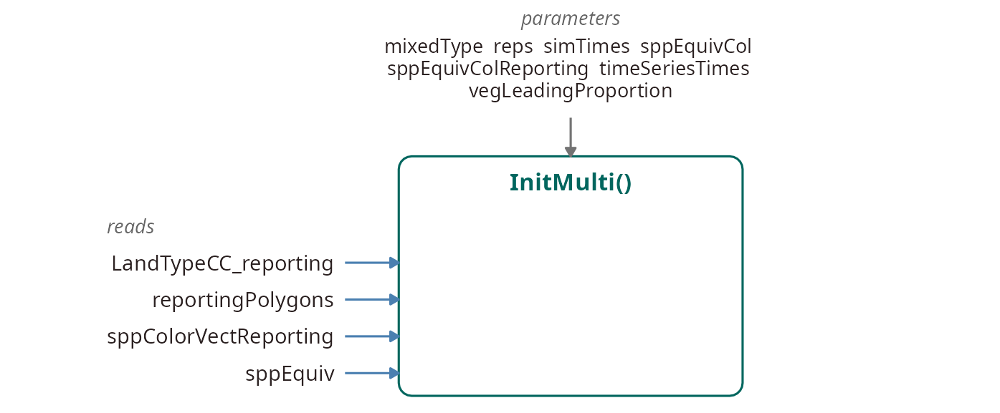
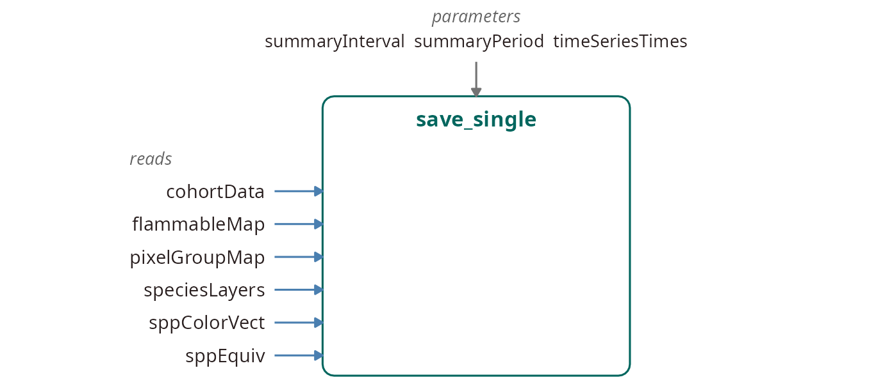

<!-- audience: ecological modellers who run NRV_summary in a SpaDES workflow; they need what each
  event computes and when, each parameter and when to change it, the files a run writes, and the
  methods behind the numbers. Prose is one sentence per line. -->

# NRV_summary Module

<!-- the following are text references used in captions for LaTeX compatibility -->
(ref:NRV-summary) *NRV_summary*


[](http://commonmark.org)

<!-- if knitting to pdf remember to add the pandoc_args: ["--extract-media", "."] option to yml in order to get the badge images -->

#### Authors:

Alex M. Chubaty <achubaty@for-cast.ca> [aut]
<!-- ideally separate authors with new lines, '\n' not working -->

## Summary

NRV_summary turns the outputs of replicate landscape simulations into the natural range of variation (NRV) of a set of landscape measures, and compares today's landscape with that range.
The NRV is the spread of landscape conditions under a natural disturbance regime, used as a reference against which current conditions and management are judged [@Landres:1999; @Keane:2009].
Where the historical record is too short or too altered to show that spread, it can be estimated by simulating the landscape over many centuries [@Keane:2009; @Keane:2018].
In this module, the range of a measure is what the replicate simulations give over the NRV years, late in the run; the current condition is the replicates' shared starting state (simulation year 0), with urban land removed when a current land-cover map is supplied.

The module runs in two modes, set by the `mode` parameter:

- `mode = "single"` (the default) runs inside each replicate simulation, beside the vegetation modules (e.g. Biomass_core).
  It saves snapshots of the landscape (maps of the leading vegetation type and stand age, and the cohort table) at year 0, at each summary time and at the end of the run.
- `mode = "multi"` runs once, after all replicates have finished.
  It reads their snapshots, computes the metrics of each replicate and reporting unit, summarises them across replicates into an envelope (the NRV), sets the current condition against it, and writes tables (CSV and parquet) and figures.

With the default parameters, mode 'multi' computes landscape metrics (`lm`) and patch metrics (`pm`).
Seven other analyses are opt-in through `postprocessEvents`: the LandWeb summaries (`lw`), BC seral stages (`bc`), stand-level measures (`st`), a figure of every metric of a unit against the NRV (`cc`), two checks that the run is long enough (`stability`, `autocorr`), and a stand-age animation (`am`); an eighth value, `on`, is a stub.

## Requirements

The module lists the packages it needs in its `reqdPkgs` metadata.
Table \@ref(tab:reqdPkgs-NRV-summary) gives those that need at least a given version.

<table class="table" style="width: auto !important; margin-left: auto; margin-right: auto;">
<caption>(\#tab:reqdPkgs-NRV-summary)Packages (ref:NRV-summary) needs at a minimum version, as its reqdPkgs state them.</caption>
 <thead>
  <tr>
   <th style="text-align:left;"> package </th>
   <th style="text-align:left;"> source </th>
   <th style="text-align:left;"> minimum </th>
  </tr>
 </thead>
<tbody>
  <tr>
   <td style="text-align:left;"> LandR </td>
   <td style="text-align:left;"> PredictiveEcology/LandR@development </td>
   <td style="text-align:left;"> 1.2.0.9054 </td>
  </tr>
  <tr>
   <td style="text-align:left;"> LandWebUtils </td>
   <td style="text-align:left;"> PredictiveEcology/LandWebUtils@development </td>
   <td style="text-align:left;"> 1.0.3.9045 </td>
  </tr>
  <tr>
   <td style="text-align:left;"> nrvtools </td>
   <td style="text-align:left;"> FOR-CAST/nrvtools </td>
   <td style="text-align:left;"> 0.5.0 </td>
  </tr>
  <tr>
   <td style="text-align:left;"> pemisc </td>
   <td style="text-align:left;"> PredictiveEcology/pemisc@development </td>
   <td style="text-align:left;"> 0.0.4.9016 </td>
  </tr>
  <tr>
   <td style="text-align:left;"> SpaDES.core </td>
   <td style="text-align:left;"> PredictiveEcology/SpaDES.core@development </td>
   <td style="text-align:left;"> 3.2.1.9077 </td>
  </tr>
</tbody>
</table>

Most of these minimum versions are those of features the module calls: SpaDES.core's replicate helpers `dirnamesFromSet()` and `repFiles()`, nrvtools' readers and writers of both cohort formats, LandR's `leadingByPixelGroup()` for the annual series, and LandWebUtils' reporting groups.
The other packages it needs, at any version, are arrow, crayon, data.table, dplyr, fs, future, future.apply, future.callr, ggforce, ggplot2, gifski, googledrive, landscapemetrics, qs2, RColorBrewer, reproducible, rlang, sf, terra, tidyterra.
Rendering this manual also needs knitr, bookdown and kableExtra, and xmlparsedata for the event figures of the appendix.

## How the module works

### Mode 'single': snapshots during each replicate

In mode 'single', NRV_summary adds two events to each replicate simulation, `map_generators` and `save_single`.
At each time they run, `map_generators` makes a map of the leading vegetation type and a map of stand age from the current cohorts, and `save_single` writes them, with the cohort table and the pixel-group map, to the replicate's output folder.
They run at simulation year 0, at each summary time, at the end of the run, and (maps only) at each year of `timeSeriesTimes`.
Year 0 is taken after every module's initialisation but before any time-0 growth or mortality, so it is the landscape the simulation starts from.
[Outputs: the replicate folder](#mode-single-the-replicate-folder) lists the files.

### Mode 'multi': summaries across replicates

In mode 'multi', NRV_summary runs in a simulation of its own after the replicates have finished.
Its `init` event finds the replicates' files (see [Finding the replicates' files](#finding-the-replicates-files)) and checks that every summary year is there.
All analyses are then scheduled at the end of that simulation, whose start and end must span `summaryPeriod` and `timeSeriesTimes` (`init` stops otherwise); `simTimes` takes them by default.
The `lm`, `pm`, `lw` and `bc` analyses read the snapshots of every replicate and summary time, compute their metrics for each unit of each reporting-polygon layer, and write one parquet partition per replicate.
They then summarise the partitions (the envelope) and set the year-0 values (the current condition) beside them.
The other analyses work from the snapshots, the annual series or those results.

### Summary times, the NRV years and year 0

Three parameters fix which simulated years are summarised:

- `summaryPeriod` (default years 700 to 1000 after the start) is the span of the summaries;
- `summaryInterval` (default 100 years) is the spacing of the summary times within it, from its first year, so the defaults give 700, 800, 900 and 1000;
- `nrvWindow` (default 1) is the last fraction of `summaryPeriod` whose summary times make up the NRV years: all of them at 1, the summary times in years 910 to 1000 at 0.3.

The `lm`, `pm` and `bc` envelope figures show every summary time, and shade the NRV years when `nrvWindow` is below 1.
The pooled summaries (`lw`, the `pm` per-class pages), every comparison of the current condition with its range, and the two run-length checks use the NRV years only.
Year 0 is the current condition throughout; it is never part of an envelope.

## Inputs

Table \@ref(tab:moduleInputs-NRV-summary) lists the module's input objects.

<table class="table" style="margin-left: auto; margin-right: auto;">
<caption>(\#tab:moduleInputs-NRV-summary)List of (ref:NRV-summary) input objects and their description.</caption>
 <thead>
  <tr>
   <th style="text-align:left;"> objectName </th>
   <th style="text-align:left;"> objectClass </th>
   <th style="text-align:left;"> desc </th>
   <th style="text-align:left;"> sourceURL </th>
  </tr>
 </thead>
<tbody>
  <tr>
   <td style="text-align:left;"> cohortData </td>
   <td style="text-align:left;"> data.table </td>
   <td style="text-align:left;"> Required in single mode. </td>
   <td style="text-align:left;"> NA </td>
  </tr>
  <tr>
   <td style="text-align:left;"> LandTypeCC_reporting </td>
   <td style="text-align:left;"> SpatRaster </td>
   <td style="text-align:left;"> Current-conditions land cover (Canada LCC 2020) with urban RETAINED. Used to correct the year-0 current-condition snapshot: the simulation imputes urban to its nearest forest type (pre-industrial state), so the year-0 rasters would otherwise report imputed forest as real current forest. Only urban differs between the sim and reporting layers -- water/barren/snow are already NA on both sides. </td>
   <td style="text-align:left;"> NA </td>
  </tr>
  <tr>
   <td style="text-align:left;"> flammableMap </td>
   <td style="text-align:left;"> SpatRaster </td>
   <td style="text-align:left;"> binary flammability map (required with `mode = 'single'`) </td>
   <td style="text-align:left;"> NA </td>
  </tr>
  <tr>
   <td style="text-align:left;"> outputsDF </td>
   <td style="text-align:left;"> data.frame </td>
   <td style="text-align:left;"> (mode = 'multi', optional) the files the replicate simulations saved, with at least a `file` column (e.g. their `outputs(sim)` row-bound). When absent, the replicate folders under `outputPath(sim)` are listed. </td>
   <td style="text-align:left;"> NA </td>
  </tr>
  <tr>
   <td style="text-align:left;"> pixelGroupMap </td>
   <td style="text-align:left;"> SpatRaster </td>
   <td style="text-align:left;"> Required in single mode. </td>
   <td style="text-align:left;"> NA </td>
  </tr>
  <tr>
   <td style="text-align:left;"> reportingPolygons </td>
   <td style="text-align:left;"> list </td>
   <td style="text-align:left;"> reporting polygons for post-processing (required with `mode = 'multi'`) </td>
   <td style="text-align:left;"> NA </td>
  </tr>
  <tr>
   <td style="text-align:left;"> speciesLayers </td>
   <td style="text-align:left;"> SpatRaster </td>
   <td style="text-align:left;"> initial percent cover raster layers used for simulation. </td>
   <td style="text-align:left;"> NA </td>
  </tr>
  <tr>
   <td style="text-align:left;"> sppColorVect </td>
   <td style="text-align:left;"> character </td>
   <td style="text-align:left;"> A named vector of colors to use for plotting. The names must be in `sim$sppEquiv[[P(sim)$sppEquivCol]]`, and should also contain a color for 'Mixed' </td>
   <td style="text-align:left;"> NA </td>
  </tr>
  <tr>
   <td style="text-align:left;"> sppColorVectReporting </td>
   <td style="text-align:left;"> character </td>
   <td style="text-align:left;"> (mode = 'multi', with `sppEquivColReporting`) named colours for the reporting groups and 'Mixed'. If absent, `LandR::sppColors()` on the reporting column. </td>
   <td style="text-align:left;"> NA </td>
  </tr>
  <tr>
   <td style="text-align:left;"> sppEquiv </td>
   <td style="text-align:left;"> data.table </td>
   <td style="text-align:left;"> table of species equivalencies. See `LandR::sppEquivalencies_CA`. </td>
   <td style="text-align:left;"> NA </td>
  </tr>
  <tr>
   <td style="text-align:left;"> standAgeMap </td>
   <td style="text-align:left;"> SpatRaster </td>
   <td style="text-align:left;"> (mode = 'single') stand age of the current forest (e.g. Biomass_borealDataPrep's), on the grid of `pixelGroupMap` or on a larger grid aligned with it. The year-0 stand-age map, with `ccStandAgeSource = 'standAgeMap'`. </td>
   <td style="text-align:left;"> NA </td>
  </tr>
  <tr>
   <td style="text-align:left;"> studyAreaReporting </td>
   <td style="text-align:left;"> SpatVector </td>
   <td style="text-align:left;"> the reporting area, required in both modes: in mode 'single' the stand-age maps are masked to it and the annual series counts its pixels; in mode 'multi' the reporting polygons are cut to it and the `st` event counts its pixels. </td>
   <td style="text-align:left;"> NA </td>
  </tr>
</tbody>
</table>

### Mode 'single'

`cohortData`, `pixelGroupMap`, `speciesLayers`, `sppColorVect`, `sppEquiv` and `studyAreaReporting` must be in the simList by the year-0 `map_generators` event, which runs after every module's `init`, so a module loaded after NRV_summary can supply them.
Biomass_core supplies `cohortData`, `pixelGroupMap`, `speciesLayers` and `sppColorVect`.
If any is missing, the run stops and names them all.
`flammableMap` is saved at the last year of the run.
`standAgeMap`, the stand-age layer of the current forest (e.g. Biomass_borealDataPrep's), is optional: it sets the current condition's stand ages when `ccStandAgeSource = "standAgeMap"` (see [The current condition](#the-current-condition)).

A study area whose `sppEquiv` has no rows has no tree species to summarise: the module says so in a message and does nothing else in either mode.

### Mode 'multi'

- `reportingPolygons` (required) is a named list of polygon layers, e.g. administrative units or ecoregions, such as `LandWebUtils::buildReportingPolygons()` makes.
  The `lm`, `pm` and `lw` events name each unit by its `Name` column and drop units without one.
  Every layer is cut to the geometry of `studyAreaReporting` (not its bounding box).
  The `bc` event reads the layer named `ecoregionLayer` (Natural Disturbance Type by biogeoclimatic zone polygons), which must have an `NDTBEC` attribute, the zone the seral-stage rules are looked up by; it takes each layer's label column from its `field` attribute.
- `studyAreaReporting` is the reporting area; the reporting polygons are cut to it, and the `st` event counts its pixels.
- `sppEquiv` names the vegetation types and defines the reporting groups (`sppEquivColReporting`).
- `LandTypeCC_reporting`, a current land-cover map with urban areas kept, removes urban land from the current condition (see [The current condition](#the-current-condition)).
  Without it the module warns and reports the simulation's year-0 state unchanged.
- `outputsDF` (optional) lists the files the replicates saved; without it, the replicate folders are listed (see [Finding the replicates' files](#finding-the-replicates-files)).
- `sppColorVectReporting` (optional) gives the colours of the reporting groups; without it, `LandR::sppColors()` picks them.

### Files read but not declared as inputs

Besides the snapshots the replicates saved, mode 'multi' reads two kinds of files written by the burnSummaries module, which are not module inputs:

- `rstTimeSinceFire_year<YYYY>.tif` in each replicate folder, which burnSummaries saves in mode 'single' at the start, at each of its own summary times and at the end of the run.
  The maps exist only at burnSummaries' summary times, so its `summaryPeriod` and `summaryInterval` must match NRV_summary's.
  Time since fire is the age basis of the `lw` summaries, and its year-0 map is their current condition.
  `init` does not check these files; without them the `lw` event cannot run.
- `burnSummaries_fireBlocks.csv`, burnSummaries' table of the area burned in each replicate and block of years, which it writes in mode 'multi'.
  The `stability` event looks for it among the outputs registered in the simList, then in `outputPath(sim)`; without it, a message says so and the burn series is not tested.

## Parameters

Table \@ref(tab:moduleParams-NRV-summary) lists every parameter with its default and range.
The subsections below say what each does and when to change it.

<table class="table" style="margin-left: auto; margin-right: auto;">
<caption>(\#tab:moduleParams-NRV-summary)List of (ref:NRV-summary) parameters and their description.</caption>
 <thead>
  <tr>
   <th style="text-align:left;"> paramName </th>
   <th style="text-align:left;"> paramClass </th>
   <th style="text-align:left;"> default </th>
   <th style="text-align:left;"> min </th>
   <th style="text-align:left;"> max </th>
   <th style="text-align:left;"> paramDesc </th>
   <th style="text-align:left;"> cacheKey </th>
  </tr>
 </thead>
<tbody>
  <tr>
   <td style="text-align:left;"> autocorrMaxLag </td>
   <td style="text-align:left;"> integer </td>
   <td style="text-align:left;"> 200 </td>
   <td style="text-align:left;"> 1 </td>
   <td style="text-align:left;"> NA </td>
   <td style="text-align:left;"> (mode = 'multi') longest lag (years) of the autocorrelation of the annual landscape series (the `autocorr` event). The longest lag used is the largest of this, `summaryInterval` and 50, cut to the number of NRV years less one when the series is shorter. </td>
   <td style="text-align:left;"> TRUE </td>
  </tr>
  <tr>
   <td style="text-align:left;"> ageClasses </td>
   <td style="text-align:left;"> character </td>
   <td style="text-align:left;"> Young, I.... </td>
   <td style="text-align:left;"> NA </td>
   <td style="text-align:left;"> NA </td>
   <td style="text-align:left;"> descriptions/labels for age classes (seral stages) </td>
   <td style="text-align:left;"> TRUE </td>
  </tr>
  <tr>
   <td style="text-align:left;"> ageClassCutOffs </td>
   <td style="text-align:left;"> integer </td>
   <td style="text-align:left;"> 0, 40, 8.... </td>
   <td style="text-align:left;"> NA </td>
   <td style="text-align:left;"> NA </td>
   <td style="text-align:left;"> defines the age boundaries between age classes </td>
   <td style="text-align:left;"> TRUE </td>
  </tr>
  <tr>
   <td style="text-align:left;"> ageClassMaxAge </td>
   <td style="text-align:left;"> integer </td>
   <td style="text-align:left;"> 400 </td>
   <td style="text-align:left;"> NA </td>
   <td style="text-align:left;"> NA </td>
   <td style="text-align:left;"> maximum possible age </td>
   <td style="text-align:left;"> TRUE </td>
  </tr>
  <tr>
   <td style="text-align:left;"> ccStandAgeSource </td>
   <td style="text-align:left;"> character </td>
   <td style="text-align:left;"> standAgeMap </td>
   <td style="text-align:left;"> NA </td>
   <td style="text-align:left;"> NA </td>
   <td style="text-align:left;"> (mode = 'single') where the current condition's (year 0's) stand-age map comes from: 'standAgeMap', the age layer `sim$standAgeMap` (e.g. Biomass_borealDataPrep's) on the pixels with cohorts, rounded and then floored to the decade, as `LandR::standAgeMapGenerator()` floors the simulated years' ages; or 'cohortData', that generator's biomass-weighted age of the year-0 cohorts, which keeps the binning of the cohort ages. 'standAgeMap' warns and uses the cohorts when `sim$standAgeMap` is absent or not on a grid aligned with `pixelGroupMap`. The simulated years always come from the cohorts. </td>
   <td style="text-align:left;"> TRUE </td>
  </tr>
  <tr>
   <td style="text-align:left;"> cohortDataFormat </td>
   <td style="text-align:left;"> character </td>
   <td style="text-align:left;"> qs2 </td>
   <td style="text-align:left;"> NA </td>
   <td style="text-align:left;"> NA </td>
   <td style="text-align:left;"> (mode = 'single') how `cohortData` is saved at the start, at each summary year and at the end: 'qs2' (the default), as `cohortData_year&lt;YYYY&gt;.qs2`, one file per year, as every run before 2.0.0.9046 saved it; or 'parquet', as an arrow dataset grouped by simulation time, `cohortData/year=&lt;YYYY&gt;/part-0.parquet` (`nrvtools::write_cohort_parquet()`). The .qs2 files are about a quarter of the size and faster to write and read; choose 'parquet' when other software (e.g. Python or DuckDB) is to read the cohorts, or to query them across years with `arrow::open_dataset()`. Mode = 'multi' reads both formats, and takes the parquet file of a replicate and year that has both. </td>
   <td style="text-align:left;"> TRUE </td>
  </tr>
  <tr>
   <td style="text-align:left;"> patchDirections </td>
   <td style="text-align:left;"> integer </td>
   <td style="text-align:left;"> 4 </td>
   <td style="text-align:left;"> 4 </td>
   <td style="text-align:left;"> 8 </td>
   <td style="text-align:left;"> patch connectivity for the 'lw' (LandWeb summary) large-patch analysis, passed to `nrvtools::largePatchCounts()` (via `landscapemetrics::get_patches`): `4` = rook / 4-connected (matches v2's GDAL `polygonize`; the default), `8` = queen / 8-connected. NOTE: v2 was fixed at 4-connectivity; exposing 8 (queen) is a departure from v2. </td>
   <td style="text-align:left;"> TRUE </td>
  </tr>
  <tr>
   <td style="text-align:left;"> mixedType </td>
   <td style="text-align:left;"> integer </td>
   <td style="text-align:left;"> 2 </td>
   <td style="text-align:left;"> NA </td>
   <td style="text-align:left;"> NA </td>
   <td style="text-align:left;"> How to define mixed stands: `0L` for none; `1L` for any species admixture; `2L` for deciduous &gt; conifer. See `LandR::vegTypeMapGenerator`. </td>
   <td style="text-align:left;"> TRUE </td>
  </tr>
  <tr>
   <td style="text-align:left;"> mode </td>
   <td style="text-align:left;"> character </td>
   <td style="text-align:left;"> single </td>
   <td style="text-align:left;"> NA </td>
   <td style="text-align:left;"> NA </td>
   <td style="text-align:left;"> use 'single' to run part of a simulation; use 'multi' to run as part of postprocessing multiple runs. </td>
   <td style="text-align:left;"> TRUE </td>
  </tr>
  <tr>
   <td style="text-align:left;"> nrvWindow </td>
   <td style="text-align:left;"> numeric </td>
   <td style="text-align:left;"> 1 </td>
   <td style="text-align:left;"> 0 </td>
   <td style="text-align:left;"> 1 </td>
   <td style="text-align:left;"> the NRV is the last fraction of `summaryPeriod` (1, the default, is all of it; 0.3 is the last 30%: with the default `summaryPeriod`, years 910-1000). Must be above 0 and at most 1. The LandWeb summaries (lw) and the per-class patch metric pages (pm) pool only the summary times in it, and the envelope figures shade it; their time series still show all of `summaryPeriod`. </td>
   <td style="text-align:left;"> TRUE </td>
  </tr>
  <tr>
   <td style="text-align:left;"> recordAnnualSeries </td>
   <td style="text-align:left;"> logical </td>
   <td style="text-align:left;"> FALSE </td>
   <td style="text-align:left;"> NA </td>
   <td style="text-align:left;"> NA </td>
   <td style="text-align:left;"> (mode = 'single') record a few landscape scalars every year (proportion young and old, mean stand age, total biomass, proportion by leading species) in `annualSeries.csv`. Off by default: it adds an event per simulated year to each replicate. The `autocorr` event of 'multi' mode reads these files to give the autocorrelation time of the landscape, hence how far apart the summary snapshots must be to be independent. </td>
   <td style="text-align:left;"> TRUE </td>
  </tr>
  <tr>
   <td style="text-align:left;"> reuseAggregates </td>
   <td style="text-align:left;"> logical </td>
   <td style="text-align:left;"> FALSE </td>
   <td style="text-align:left;"> NA </td>
   <td style="text-align:left;"> NA </td>
   <td style="text-align:left;"> (mode = 'multi') if TRUE, reuse a complete per-replicate `_aggregates` parquet dataset instead of recomputing it, re-summarizing the surviving parquets to regenerate the envelopes/CSVs/figures. Use to iterate on the plots/CSVs without re-running the (~hours) landscape-metric aggregation; leave FALSE for a fresh run. </td>
   <td style="text-align:left;"> TRUE </td>
  </tr>
  <tr>
   <td style="text-align:left;"> envelopeStyle </td>
   <td style="text-align:left;"> character </td>
   <td style="text-align:left;"> ribbon </td>
   <td style="text-align:left;"> NA </td>
   <td style="text-align:left;"> NA </td>
   <td style="text-align:left;"> (mode = 'multi') how the lm and pm envelope figures show the replicates: `"ribbon"` (default) draws the range of the replicates as a band around their mean; `"lines"` draws one thin grey line per replicate under a bold line for their median (`nrvtools::plot_nrv_envelope(type = "lines")`). The files keep their names (`&lt;subregion&gt; &lt;metric&gt;_ribbon.png`, `&lt;metric&gt;_ribbon_p&lt;N&gt;.png`). The replicate values are read once per reporting layer; a layer whose aggregates hold none gets ribbons, and a message says so. The boxplot figures and the per-class pages are the same in both styles. </td>
   <td style="text-align:left;"> TRUE </td>
  </tr>
  <tr>
   <td style="text-align:left;"> plotWorkers </td>
   <td style="text-align:left;"> integer </td>
   <td style="text-align:left;"> 8 </td>
   <td style="text-align:left;"> 1 </td>
   <td style="text-align:left;"> NA </td>
   <td style="text-align:left;"> (mode = 'multi') hard cap on the number of local worker processes used to render the postprocess figures in parallel (each figure is an independent `ggsave`). The actual count is RAM-aware (`pemisc::optimalClusterNum`) but never exceeds this cap, so a shared compute node is not swamped; 1 renders sequentially. Uses `future` multisession (not fork; the crew worker is a mirai daemon). </td>
   <td style="text-align:left;"> TRUE </td>
  </tr>
  <tr>
   <td style="text-align:left;"> postprocessEvents </td>
   <td style="text-align:left;"> character </td>
   <td style="text-align:left;"> lm, pm </td>
   <td style="text-align:left;"> NA </td>
   <td style="text-align:left;"> NA </td>
   <td style="text-align:left;"> Specify which subset of postprocessing events to run. At least one of: 'am' for the stand-age time-series animation (GIF); 'bc' for BC seral stage patch metrics; 'lm' for default landscape metrics; 'lw' for default LandWeb summaries; 'pm' for default patch metrics; 'on' for Ontario NRV metrics, a stub that does nothing yet but print a message; 'st' for stand-level measures (age-class, leading-type and forested shares, total biomass) at each summary time, from the saved snapshots (`st.csv`, `st_CC.csv`, `st_nrvComparison.csv`) and their figures; with 'stability' in the same run they are tested too. With 'lm' in the same run, also the NRV comparison tables, `csv/lm/&lt;layer&gt;/lm_nrvComparison.csv`, which say where the current condition falls against the NRV range. Not in the default: it runs only when asked for. 'cc' for one figure per reporting layer and unit with the lm and st metrics against the NRV (`figures/all/&lt;layer&gt;/&lt;unit&gt;.png`), with 'lm' or 'st' in the same run: it draws the comparisons those events record. The stand-level rows go on the figure of every unit named like the study area (`.studyAreaName`); with no such unit they have a figure of their own, `figures/all/&lt;studyArea&gt;/&lt;studyArea&gt;.png`. With 'cc' in the run, the 'lm' event also writes the NRV comparison tables. Not in the default: it runs only when asked for. 'autocorr' for the autocorrelation time of the annual landscape series (`annualSeries.csv`, from `recordAnnualSeries = TRUE`), the correlation between snapshots `summaryInterval` years apart and a recommended thinning interval; `autocorrelation.csv` and its figure. Not in the default: it runs only when asked for. 'stability' for the check that the run is long enough (is each metric still trending over the end of the NRV period?), `stability.csv` and its figures, and, with 'lm' in the same run, the current-condition overview of each lm layer. Not in the default: it runs only when asked for. Any other value is an error ('fd', forest degradation indicators, is not implemented). </td>
   <td style="text-align:left;"> TRUE </td>
  </tr>
  <tr>
   <td style="text-align:left;"> stabilityAlpha </td>
   <td style="text-align:left;"> numeric </td>
   <td style="text-align:left;"> 0.05 </td>
   <td style="text-align:left;"> 0 </td>
   <td style="text-align:left;"> 1 </td>
   <td style="text-align:left;"> (mode = 'multi') significance level of the Mann-Kendall trend test in the stability check (the `stability` event). </td>
   <td style="text-align:left;"> TRUE </td>
  </tr>
  <tr>
   <td style="text-align:left;"> stabilityMinChange </td>
   <td style="text-align:left;"> numeric </td>
   <td style="text-align:left;"> 0.1 </td>
   <td style="text-align:left;"> 0 </td>
   <td style="text-align:left;"> 1 </td>
   <td style="text-align:left;"> (mode = 'multi') a series is flagged 'still changing' only if its fitted change across the stability window exceeds this fraction of the series' range (its largest minus smallest value over all reps within the window), as well as being a significant trend. </td>
   <td style="text-align:left;"> TRUE </td>
  </tr>
  <tr>
   <td style="text-align:left;"> stabilityWindow </td>
   <td style="text-align:left;"> numeric </td>
   <td style="text-align:left;"> 0.5 </td>
   <td style="text-align:left;"> 0 </td>
   <td style="text-align:left;"> 1 </td>
   <td style="text-align:left;"> (mode = 'multi') the last fraction of the NRV period (`summaryPeriod` when `nrvWindow` is 1) over which the stability check looks for a directional trend (0.5 = the last half). A run whose metrics are still trending there needs to be longer. It does not define the NRV (see `nrvWindow`). </td>
   <td style="text-align:left;"> TRUE </td>
  </tr>
  <tr>
   <td style="text-align:left;"> reps </td>
   <td style="text-align:left;"> integer </td>
   <td style="text-align:left;"> 1, 2, 3,.... </td>
   <td style="text-align:left;"> 1 </td>
   <td style="text-align:left;"> NA </td>
   <td style="text-align:left;"> (mode = 'multi') the ids of the replicates to summarise, not their number: e.g. `1:15` for folders `rep01` to `rep15` (or `rep1` to `rep15`). `init` stops if fewer replicates are found than it lists. </td>
   <td style="text-align:left;"> TRUE </td>
  </tr>
  <tr>
   <td style="text-align:left;"> sieveThresh </td>
   <td style="text-align:left;"> integer </td>
   <td style="text-align:left;"> 1 </td>
   <td style="text-align:left;"> NA </td>
   <td style="text-align:left;"> NA </td>
   <td style="text-align:left;"> threshold patch size (number of pixels) to use with `terra::sieve` when creating seral stage maps </td>
   <td style="text-align:left;"> TRUE </td>
  </tr>
  <tr>
   <td style="text-align:left;"> simTimes </td>
   <td style="text-align:left;"> numeric </td>
   <td style="text-align:left;"> NA, NA </td>
   <td style="text-align:left;"> NA </td>
   <td style="text-align:left;"> NA </td>
   <td style="text-align:left;"> (mode = 'multi') the start and end years of the replicate runs, which name their year-0 and last-year files. NA (the default) takes the start and end of this simulation (`SpaDES.core::resolveSimYears()`). </td>
   <td style="text-align:left;"> TRUE </td>
  </tr>
  <tr>
   <td style="text-align:left;"> sppEquivCol </td>
   <td style="text-align:left;"> character </td>
   <td style="text-align:left;"> LandR </td>
   <td style="text-align:left;"> NA </td>
   <td style="text-align:left;"> NA </td>
   <td style="text-align:left;"> The column in `sim$sppEquiv` data.table to use as a naming convention </td>
   <td style="text-align:left;"> TRUE </td>
  </tr>
  <tr>
   <td style="text-align:left;"> sppEquivColReporting </td>
   <td style="text-align:left;"> character </td>
   <td style="text-align:left;"> NA </td>
   <td style="text-align:left;"> NA </td>
   <td style="text-align:left;"> NA </td>
   <td style="text-align:left;"> (mode = 'multi') column of `sim$sppEquiv` that groups the simulated species (`sppEquivCol`) for reporting. When set, the vegetation-type maps that the 'lm', 'lw' and 'pm' analyses read, for the simulated years and for current conditions, are rebuilt from the saved `cohortData` and `pixelGroupMap` with each species recoded to its group, so biomass is summed within a group before the leading type is decided. `LandR::vegTypeMapGenerator()` sums only within a code, so relabelling the species-level maps would not give this. `NA` (the default) analyses the species-level maps the simulation saved. </td>
   <td style="text-align:left;"> TRUE </td>
  </tr>
  <tr>
   <td style="text-align:left;"> summaryInterval </td>
   <td style="text-align:left;"> integer </td>
   <td style="text-align:left;"> 100 </td>
   <td style="text-align:left;"> NA </td>
   <td style="text-align:left;"> NA </td>
   <td style="text-align:left;"> simulation time interval at which to take 'snapshots' used for summary analyses. </td>
   <td style="text-align:left;"> TRUE </td>
  </tr>
  <tr>
   <td style="text-align:left;"> summaryPeriod </td>
   <td style="text-align:left;"> integer </td>
   <td style="text-align:left;"> 700, 1000 </td>
   <td style="text-align:left;"> NA </td>
   <td style="text-align:left;"> NA </td>
   <td style="text-align:left;"> lower and upper end of the range of simulation times used for summary analyses. </td>
   <td style="text-align:left;"> TRUE </td>
  </tr>
  <tr>
   <td style="text-align:left;"> timeSeriesTimes </td>
   <td style="text-align:left;"> numeric </td>
   <td style="text-align:left;"> 0, 1, 2,.... </td>
   <td style="text-align:left;"> NA </td>
   <td style="text-align:left;"> NA </td>
   <td style="text-align:left;"> simulation times for which to build time series animations; the default is start + 601:650 when the run is that long, otherwise the last 50 years of the run. </td>
   <td style="text-align:left;"> TRUE </td>
  </tr>
  <tr>
   <td style="text-align:left;"> vegLeadingProportion </td>
   <td style="text-align:left;"> numeric </td>
   <td style="text-align:left;"> 0.75 </td>
   <td style="text-align:left;"> 0 </td>
   <td style="text-align:left;"> 1 </td>
   <td style="text-align:left;"> A number that defines whether a species is leading for a given pixel. Default: `LandR::leadingSpeciesProp()`, i.e. option `LandR.leadingSpeciesProp`, which takes `LandR.mixedwoodProp` (0.75) unless set. Setting it in one place moves every module and LandR function together. </td>
   <td style="text-align:left;"> TRUE </td>
  </tr>
  <tr>
   <td style="text-align:left;"> .plots </td>
   <td style="text-align:left;"> character </td>
   <td style="text-align:left;"> screen </td>
   <td style="text-align:left;"> NA </td>
   <td style="text-align:left;"> NA </td>
   <td style="text-align:left;"> Used by `SpaDES.core::Plots`, which can be optionally used here. </td>
   <td style="text-align:left;"> TRUE </td>
  </tr>
  <tr>
   <td style="text-align:left;"> .plotInitialTime </td>
   <td style="text-align:left;"> numeric </td>
   <td style="text-align:left;"> 0 </td>
   <td style="text-align:left;"> NA </td>
   <td style="text-align:left;"> NA </td>
   <td style="text-align:left;"> Describes the simulation time at which the first plot event should occur. </td>
   <td style="text-align:left;"> TRUE </td>
  </tr>
  <tr>
   <td style="text-align:left;"> .plotInterval </td>
   <td style="text-align:left;"> numeric </td>
   <td style="text-align:left;"> NA </td>
   <td style="text-align:left;"> NA </td>
   <td style="text-align:left;"> NA </td>
   <td style="text-align:left;"> Describes the simulation time interval between plot events. </td>
   <td style="text-align:left;"> TRUE </td>
  </tr>
  <tr>
   <td style="text-align:left;"> .studyAreaName </td>
   <td style="text-align:left;"> character </td>
   <td style="text-align:left;"> NA </td>
   <td style="text-align:left;"> NA </td>
   <td style="text-align:left;"> NA </td>
   <td style="text-align:left;"> Human-readable name for the study area used, or a hash of the study area obtained using `reproducible::studyAreaName()`. </td>
   <td style="text-align:left;"> TRUE </td>
  </tr>
  <tr>
   <td style="text-align:left;"> .seed </td>
   <td style="text-align:left;"> list </td>
   <td style="text-align:left;">  </td>
   <td style="text-align:left;"> NA </td>
   <td style="text-align:left;"> NA </td>
   <td style="text-align:left;"> Named list of seeds to use for each event (names). </td>
   <td style="text-align:left;"> TRUE </td>
  </tr>
  <tr>
   <td style="text-align:left;"> .useCache </td>
   <td style="text-align:left;"> logical </td>
   <td style="text-align:left;"> FALSE </td>
   <td style="text-align:left;"> NA </td>
   <td style="text-align:left;"> NA </td>
   <td style="text-align:left;"> Should caching of events or module be used? </td>
   <td style="text-align:left;"> TRUE </td>
  </tr>
</tbody>
</table>

### Mode, years and replicates

- `mode` (`"single"`): `"single"` inside each replicate run, `"multi"` once over all of them.
  Each mode needs its own simulation.
- `summaryPeriod` (start + `c(700, 1000)`): the first and last summary times.
  `init` stops if either lies outside the run.
  The summaries describe the landscape under its disturbance regime, not its drift away from the starting (current) landscape, so the period lies late in the run; the `stability` event checks whether metrics still trend there.
- `summaryInterval` (100): years between summary times.
  The snapshots are meant to be nearly independent samples of the landscape, so set it no shorter than the recommended thinning that the `autocorr` event gives.
  A shorter interval gives more snapshots, more files and longer summaries.
- `nrvWindow` (1): the last fraction of `summaryPeriod` that makes up the NRV years; above 0 and at most 1.
  `init` stops when no summary time falls in it ("raise nrvWindow or lower summaryInterval").
  Lower it when the first part of `summaryPeriod` is still a transient.
  Changing it rebuilds the `lw` aggregates even with `reuseAggregates = TRUE`.
- `timeSeriesTimes` (start + 601:650 when the run is at least 650 years long, otherwise the last 50 years of the run): the years whose stand-age and vegetation-type maps mode 'single' also saves, and the frames of the `am` animation.
  `NA` takes the default; `init` stops if a year lies outside the run.
- `reps` (`1:10`, mode 'multi'): the ids of the replicates to summarise, e.g. `c(2, 5)` for folders `rep2` and `rep5` (or `rep02` and `rep05`).
  It is a vector of ids, not a count, and `init` stops if fewer replicates are found than it holds.
  Set it to the replicates you ran.
- `simTimes` (`c(NA, NA)`, mode 'multi'): the start and end years of the replicate runs.
  They name the year-0 files (e.g. `_year0000`) and the last year's flammable map.
  `NA` takes the start and end of the mode 'multi' simulation (`SpaDES.core::resolveSimYears()`); set it when those differ from the replicate runs' start and end.

### Vegetation types

- `sppEquivCol` (`"LandR"`): the column of `sppEquiv` that names the simulated species.
- `sppEquivColReporting` (`NA`, mode 'multi'): a column of `sppEquiv` that groups the simulated species for reporting (see [Reporting by groups](#reporting-by-groups-of-the-simulated-species)).
- `vegLeadingProportion` (`LandR::leadingSpeciesProp()`, 0.75 unless the option `LandR.leadingSpeciesProp` or `LandR.mixedwoodProp` is set): the share of a pixel's biomass a species needs to lead it; `mixedType` sets how a pixel without such a species is classed.
  Setting the LandR option moves this module and the Biomass modules together.
  The default was 0.8 before version 2.0.0.9028.
- `mixedType` (2): how mixed stands are defined, passed to `LandR::vegTypeMapGenerator()`: 0 for none, 1 for any species admixture, 2 for deciduous above conifer.

### Age classes

- `ageClasses` (`"Young"`, `"Immature"`, `"Mature"`, `"Old"`) and `ageClassCutOffs` (0, 40, 80, 120): the labels and the lower age bounds of the age classes; give as many cut-offs as labels.
  They bin time since fire in the `lw` summaries (an age equal to a cut-off falls in the class below: 40 years is Young), and stand age in the `st` measures and the `am` animation (a class starts at its cut-off: 40 years is Immature).
  In the annual series, `propYoung` is the forest younger than the first cut-off above 0 and `propOld` the forest at or above the last cut-off.
- `ccStandAgeSource` (`"standAgeMap"`, mode 'single'): where the year-0 stand-age map comes from (see [The current condition](#the-current-condition)): `"standAgeMap"`, the stand-age layer `sim$standAgeMap`, or `"cohortData"`, the year-0 cohorts.
  Any other value stops `init`.

### Saving (mode 'single')

- `cohortDataFormat` (`"qs2"`): `"qs2"` saves `cohortData` as one `.qs2` file per year; `"parquet"` as a parquet dataset grouped by year (see [Cohort data formats](#cohort-data-formats)).
  Any other value stops `init`.
- `recordAnnualSeries` (`FALSE`): `TRUE` adds an `annual_series` event every simulated year, which writes `annualSeries.csv` for the `autocorr` check.
  It adds about one event per year to each replicate.

### Analyses (mode 'multi')

- `postprocessEvents` (`c("lm", "pm")`): the analyses to run, any of `"am"`, `"autocorr"`, `"bc"`, `"cc"`, `"lm"`, `"lw"`, `"on"`, `"pm"`, `"st"` and `"stability"` (upper or lower case).
  Any other value stops `init` before any work.
  `"on"` (Ontario NRV metrics) is a stub that only prints a message.
- `patchDirections` (4): the connectivity of the large patches of the `lw` summaries: 4 joins cells that share an edge (rook), as LandWeb's v2 summaries did; 8 also joins cells that touch at a corner (queen).
  It does not apply to the `lm` and `pm` metrics, which use landscapemetrics' default of 8 (see [Methods](#methods)).
- `sieveThresh` (1): in the `bc` event, seral-stage patches of fewer pixels than this are merged into a neighbouring patch with `terra::sieve()` before the patch metrics are taken.
  With the default no patch is that small, so the sieved maps (written with the suffix `-sieve1`) hold the same values; `NA` skips sieving.
- `stabilityAlpha` (0.05), `stabilityMinChange` (0.10) and `stabilityWindow` (0.5): the significance level of the trend test, the smallest change worth flagging (as a fraction of a series' range in the window), and the last fraction of the NRV years that the `stability` event tests (see [Is the run long enough?](#is-the-run-long-enough)).
- `autocorrMaxLag` (200): the longest lag, in years, of the `autocorr` event's autocorrelation; the lag used is the largest of this, `summaryInterval` and 50, cut to the number of NRV years less one.

### Figures, re-runs and labels (mode 'multi')

- `envelopeStyle` (`"ribbon"`): `"ribbon"` draws the replicates' range as a band around their mean; `"lines"` draws one thin grey line per replicate under a bold line for their median.
  It applies to the `lm` and `pm` envelope figures; any other value stops `init`.
- `plotWorkers` (8): the most worker processes used to draw the figures in parallel; fewer are used when memory is short (`pemisc::optimalClusterNum()`), and 1 draws them one at a time.
  Lower it on a shared machine.
- `reuseAggregates` (`FALSE`): `TRUE` reuses an `_aggregates/<refCode>` dataset that has a partition for every replicate instead of recomputing it, and rebuilds the envelopes, CSVs and figures from it.
  Use it to redraw figures after changing only figure settings.
  It does not notice changed maps, reporting polygons or metrics; only the `lw` datasets also check their NRV years (`nrvYears.txt`).
  Leave it `FALSE` for a new run.
- `.studyAreaName` (`NA`): the study area's name, used in figure titles, as the folder and unit name of the `st` outputs (`"unit"` when `NA`), to match the stand-level rows to a unit on the `cc` figures, and to label the burn series of the `stability` event.

### Parameters the code does not read

The module's own code does not read `ageClassMaxAge`, `.plots`, `.plotInitialTime`, `.plotInterval`, `.seed` or `.useCache`, and nothing reads the first four.
SpaDES.core reads the other two when it runs an event: `.seed`, a list named by event type, seeds the random-number generator for those events, and `.useCache` caches all of the module's events (`TRUE`) or the events it names.
Keep `.useCache = FALSE`: an event taken from the cache is not run, so a cached mode 'multi' event can skip writing its files.
The figures are always written as PNG files.
The metric calculations of `lm`, `pm`, `lw` and `bc` are wrapped in `reproducible::Cache()`, keyed on their arguments and on the size and modification time of the maps they read; reproducible's own option `reproducible.useCache` controls that cache, not `.useCache`.

## Events

Table \@ref(tab:events-NRV-summary) lists the events in the order they run within their mode.
In mode 'multi', every analysis is scheduled at the end of the simulation, in this order, followed by `postprocess` and `plot`; `stability` runs last.

Table: (\#tab:events-NRV-summary) The events of (ref:NRV-summary), in run order.

| Event | `postprocessEvents` value | Mode | Default | What it does |
|---|---|---|---|---|
| `init` | | both | always | checks the parameters; in mode 'multi', finds the replicate files |
| `map_generators` | | single | always | vegetation-type and stand-age maps |
| `save_single` | | single | always | writes the snapshots |
| `annual_series` | | single | `recordAnnualSeries = TRUE` | one row of landscape scalars per year |
| `animation` | `am` | multi | opt-in | stand-age GIF |
| `postprocess_lm` | `lm` | multi | yes | landscape metrics |
| `postprocess_pm` | `pm` | multi | yes | patch and class metrics |
| `postprocess_lw` | `lw` | multi | opt-in | leading type by age class, large patches |
| `postprocess_bc` | `bc` | multi | opt-in | BC seral stages and their patch areas |
| `postprocess_on` | `on` | multi | opt-in | stub: prints a message |
| `postprocess_st` | `st` | multi | opt-in | stand-level measures |
| `postprocess_autocorr` | `autocorr` | multi | opt-in | autocorrelation of the annual series |
| `postprocess_cc` | `cc` | multi | opt-in | every lm and st metric of a unit against the NRV |
| `postprocess` | | multi | always | registers the files written as outputs |
| `plot` | | multi | always | envelope and summary figures |
| `postprocess_stability` | `stability` | multi | opt-in | trend test over the end of the NRV years |

### init

In both modes, `init` fills in `timeSeriesTimes` when it is `NA`, schedules nothing when `sppEquiv` has no rows, and stops with a message when `summaryPeriod` or `timeSeriesTimes` lie outside the run, when `nrvWindow`, `envelopeStyle` or `cohortDataFormat` has a value it does not accept, or when no summary time is an NRV year.
With `"stability"` in `postprocessEvents`, it warns when the stability window holds fewer than 3 summary times (the defaults hold 2: 900 and 1000).

In mode 'single', it checks `ccStandAgeSource` and schedules the snapshot events: year 0 at priority `.first() + 1`, so after every module's `init` and before any time-0 dynamics (e.g. Biomass_core's growth and mortality, at priority 6, when its `growthInitialTime` is the start of the run); then the first summary time, the end of the run and each `timeSeriesTimes` year, each once, at the end of its year.
Each summary-time event schedules the next one `summaryInterval` years later, up to the end of `summaryPeriod`.

In mode 'multi', it checks `postprocessEvents` and that `reportingPolygons` is supplied, then finds and checks the replicate files (see [Finding the replicates' files](#finding-the-replicates-files)), writes the urban-masked current-condition maps (with `LandTypeCC_reporting`) and the reporting-group maps (with `sppEquivColReporting`), and schedules the analyses.

### map_generators and save_single (mode 'single')

`map_generators` makes the vegetation-type map with `LandR::vegTypeMapGenerator()`: each pixel's leading species, or mixed, from its cohorts' biomass, `vegLeadingProportion` and `mixedType`.
It makes the stand-age map with `LandR::standAgeMapGenerator()`: the biomass-weighted mean age of each pixel's cohorts, floored to the decade.
At year 0 the stand ages come from `ccStandAgeSource` (see [The current condition](#the-current-condition)).
The stand-age map is masked to `studyAreaReporting`.
At its first run, the event checks that the vegetation inputs are present.

`save_single` writes those maps and the other snapshot files (see [Outputs: the replicate folder](#mode-single-the-replicate-folder)) to `outputPath(sim)`, and registers each with `registerOutputs()`.
It stops if a vegetation-type code is 255 or more, which an 8-bit file cannot hold.

### annual_series (mode 'single', opt-in)

With `recordAnnualSeries = TRUE`, an `annual_series` event runs at the end of every simulated year, from year 0 to the last, and the last one writes `annualSeries.csv` beside the replicate's other files.
Each row covers the reporting area (`studyAreaReporting`) and is computed from the cohorts and a count of each pixel group's pixels, with no maps made:

- `time`;
- `propYoung`, the proportion of the forest younger than the first cut-off above the youngest (40 years with the default `ageClassCutOffs`);
- `propOld`, the proportion at or above the last cut-off (120 years);
- `meanStandAge`, the mean over the forest of each pixel's biomass-weighted stand age, floored to the decade as in the stand-age maps;
- `totalBiomassTg`, the total biomass in teragrams;
- `lead_<species>`, the proportion of the forest led by each species (`lead_Mixed` for mixed stands), as `LandR::leadingByPixelGroup()` decides it.

A forested pixel is one whose pixel group has cohorts.
The year-0 row is taken at the end of year 0 from the cohorts, so its ages are the cohorts' ages even when the year-0 map uses the stand-age layer.

### postprocess_lm: landscape metrics (default)

For each reporting layer and unit, the `lm` event computes ten landscape-level metrics of the vegetation-type map of every replicate and summary time, with landscapemetrics [@Hesselbarth:2019; @R-landscapemetrics] through `nrvtools::nrv_metrics_landscape()`:

- mean and standard deviation of patch area (`lsm_l_area_mn`, `lsm_l_area_sd`);
- aggregation index (`lsm_l_ai`);
- patch cohesion index (`lsm_l_cohesion`) [@Schumaker:1996];
- conditional entropy (`lsm_l_condent`);
- mean, standard deviation and coefficient of variation of core area (`lsm_l_core_mn`, `lsm_l_core_sd`, `lsm_l_core_cv`);
- edge density (`lsm_l_ed`);
- interspersion and juxtaposition index (`lsm_l_iji`).

It computes the same for the current condition.
The envelope at each summary time is the distribution of one value per replicate, so `n_reps` counts the replicates with a value (see [Methods](#methods)).
The tables are `csv/lm/<layer>/lm.csv` (and one file per metric, `lm_<metric>.csv`) for the replicates and `lm_CC.csv` for the current condition.
With `"st"` or `"cc"` in the same run, it also writes `lm_nrvComparison.csv`: for each unit and metric, the NRV range and whether the current condition is inside, above or below it.

### postprocess_pm: patch and class metrics (default)

For each reporting layer and unit, the `pm` event computes, for each vegetation type, through `nrvtools::calculatePatchMetrics()`:

- the area of each patch (`area`) and the median stand age of each patch (`sam_mdn`);
- the class-level aggregation index (`lsm_c_ai`), mean, standard deviation and coefficient of variation of patch area (`lsm_c_area_mn`, `lsm_c_area_sd`, `lsm_c_area_cv`) and total class area (`lsm_c_ca`).

It reads the vegetation-type and stand-age maps, and the first replicate's flammable map masks only the stand-age map: the patches, their areas and the class-level metrics include non-flammable pixels, and only the patch ages (`sam_mdn`) leave them out.
Non-flammable pixels have no cohorts and so no vegetation type, so in practice the vegetation-type metrics are unaffected.
A patch-level metric enters the envelope as each replicate's mean over its patches, so the envelope spans the replicates, as for a class-level metric.
A class absent from a map has no row in landscapemetrics' output; the event adds a class area of 0 ha (in `ca_zeros.parquet`) for each class that a unit shows in its current condition or in any replicate-year but lacks in a replicate-year, so the class-area envelopes count the replicate-years without the class.
Class codes are labelled with the vegetation types' names.
The tables are `csv/pm/<layer>/pm.csv`, `pm_<metric>.csv`, `pm_CC.csv` and `pm_CC_<metric>.csv`.

### postprocess_lw: LandWeb summaries (opt-in)

The `lw` event computes two summaries carried over from LandWeb's earlier (v2) summaries; they are the module's own definitions.
Both bin the time-since-fire map of each replicate and NRV year into the age classes (`ageClasses`, `ageClassCutOffs`; an age equal to a cut-off falls in the class below), and both use the vegetation-type map:

- `leadingVegByAgeClass`: for each vegetation type, the proportion of its forest in each age class (`leadingProp`, with an `All species` row over every type), and each type and age class as a share of all forest (`leadingShare`).
- `largePatchCounts`: patches of one vegetation type and age class (and, for `All species`, of one age class), joined with `patchDirections` connectivity; patches under 100 ha are dropped, and for each threshold of 100, 500, 1,000 and 5,000 ha the event counts the patches at least that large (`Npatch_ge<size>ha`) and their total area (`totalArea_ge<size>ha`).

The NRV distribution pools the replicates and the NRV years, so `n_reps` in its tables counts replicate-years.
Pixels are not masked by the flammable map.
A vegetation type that a unit shows but lacks in a replicate-year gets 0 in `leadingShare` and the large-patch counts and areas there (`lw_zeros.parquet`); its `leadingProp` stays undefined, since it has no forest to divide.
The tables are `csv/boxplots/<layer>/leading.csv` (and `leading_<metric>.csv`, `leading_CC.csv`) and `csv/histograms/<layer>/largePatches.csv` (and the same variants).
The NRV years the aggregates were built from are recorded in `_aggregates/lw_<layer>/nrvYears.txt`.

### postprocess_bc: BC seral stages (opt-in)

The `bc` event maps seral stages for British Columbia and then takes their patch areas.
The seral-stage recipe was ported from a BC Government ArcPy script given to the module's author.
From each cohort table and pixel-group map (year 0 of the first replicate, and every replicate's summary times), `nrvtools::writeSeralStageMapBC()` assigns each pixel a seral stage (early, mid, mature or old; in Natural Disturbance Type 4 also by leading Fir, Pine or other species) from the age of its cohorts and its Natural Disturbance Type and biogeoclimatic zone, read from the `ecoregionLayer` reporting polygons.
The maps are written as `seralStageMap_year<YYYY>.tif` in each replicate folder, and sieved with `sieveThresh` (`seralStageMap_year<YYYY>-sieve<N>.tif`).
For each reporting layer and unit, the event then takes the area of each seral-stage patch, masked by the flammable map, through `nrvtools::calculatePatchMetricsSeral()`; the tables are in `csv/sspm/<layer>/`.
Its envelope pools every patch of every replicate at each summary time, so `n_reps` in those tables counts patches, not replicates, and the figures carry no caption.
The year-0 files are always those named `_year0000` in the first replicate's folder, whatever `simTimes` says.
The current condition's seral map is built from the first replicate's year-0 cohorts and pixel-group map, which the urban mask does not reach, so it still counts urban land as forest (a known limitation).
For a reporting layer named `NDTBEC`, it also writes `SeralTable.csv` in `outputPath(sim)`: the smallest, mean and largest percentage of each polygon's area in each seral stage over the summary times.
The cropped polygons are written as `NDTBEC.shp` in `outputPath(sim)`.

### postprocess_st: stand-level measures (opt-in)

For each replicate and summary time, and for the current condition, the `st` event takes over the reporting area:

- `age_<class>`: the share of the forested area in each age class (from the stand-age map; a class starts at its cut-off);
- `forested`: the forested share of the area (a pixel is forested when it has a stand age and a pixel group above 0);
- `lead_<type>`: the share of the area led by each vegetation type, mixed included (every pixel with a type counts, forested or not);
- `biomassTg`: the total tree biomass of the forested pixels, in teragrams.

A type absent from a snapshot leads 0% of it.
The envelope at each time is the replicates' mean, minimum and maximum.
It writes `csv/st/<studyArea>/st.csv` (the replicates), `st_CC.csv` (the current condition) and `st_nrvComparison.csv` (the NRV range and whether the current condition is inside, above or below it), and its figures (see [Figures](#figures)).
With `"stability"` in the same run, the stand series are also tested for trends.
It stops if a summary-time pixel-group map, or the year-0 one, has no cohort file.

### postprocess_autocorr: autocorrelation of the annual series (opt-in)

The `autocorr` event estimates how far apart the summary snapshots must be to be nearly independent (see [Is the run long enough?](#is-the-run-long-enough)).
It reads the `annualSeries.csv` files found in the replicate folders; a file left by an earlier run with `recordAnnualSeries = TRUE` is read if the folder was not cleared.
A replicate whose file does not cover the NRV years is left out with a warning, and a series missing from a replicate's file is left out with a message.

`csv/autocorrelation/autocorrelation.csv` has one row per series:

- `phi`, the pooled lag-1 autocorrelation over the NRV years (cut to between 0 and 0.999), and `tau`, the autocorrelation time it implies, `(1 + phi) / (1 - phi)`;
- `ar1Misfit`, the largest difference between the pooled autocorrelation at lags 1 to 50 and the exponential decay `phi^lag` (near 0 when the decay is exponential);
- `r`, `rMin`, `rMax`: the correlation at lag `summaryInterval`, pooled and the lowest and highest of the replicates' own;
- `effectiveSnapshots`, the effective number of independent snapshots in the NRV years of all replicates;
- `tauGeyer`, Geyer's estimate of the autocorrelation time, kept for comparison;
- `lagBelow0.1`, the first lag at which the pooled autocorrelation is below 0.1;
- `label`, `recommendedThin` (the largest `tau`, rounded up), `summaryInterval` and `nSnapshots` (the summary times in the NRV years over all replicates).

The figure is `figures/autocorrelation/all/autocorrelation.png`.
Without `annualSeries.csv` files the event says so, removes an earlier run's table and figure, and writes nothing.

### postprocess_cc: the current condition against the NRV (opt-in)

For each reporting layer and unit, the `cc` event draws one figure with the current condition of each lm metric and stand-level (st) measure against its NRV range (the pm, lw and bc metrics are not on it), from the comparisons the `lm` and `st` events record; it needs one of them in the run.
Each range is rescaled to run from 0 (lowest) to 1 (highest simulated value), and a current condition beyond -1 or 2 is drawn at the limit with an arrow and its value.
The stand-level rows go on the figure of every unit named like the study area (`.studyAreaName`); with no such unit they have a figure of their own.
The event runs after `lm`, `st` and `autocorr`, and empties its folder, `figures/all/`, before it draws.

### postprocess and plot

`postprocess` registers the parquet aggregates, CSVs and the animation with `registerOutputs()`, so a pipeline that tracks the module's outputs (e.g. a targets stage) sees them.

`plot` draws the figures of `lm`, `pm`, `lw` and `bc` (see [Figures](#figures)) and registers them.
It first empties the figure folders of the events in this run.
The figures are drawn in parallel by up to `plotWorkers` R processes (`future` multisession); a figure that fails to draw gives a warning naming its file, and the others are still drawn.

### postprocess_stability: is the run long enough? (opt-in)

The `stability` event tests each series for a trend over the last `stabilityWindow` of the NRV years (see [Is the run long enough?](#is-the-run-long-enough)).
The series are the landscape- and class-level metrics of the `lm` and `pm` events in the run (each replicate and summary time), the `st` measures when `st` ran, and the area burned per block of years from burnSummaries' `burnSummaries_fireBlocks.csv` (only the blocks wholly inside the window).
It writes `csv/stability/all/stability.csv`, with the columns `kind`, `layer`, `poly`, `level`, `class`, `metric`, `nTimes` (the summary times in the window), `slope` (per year), `p`, `changePctRange` (the fitted change over the window as a percentage of the series' range in the window) and `flag` (`"still changing"`, `"stable"` or `"insufficient"`).
Its figures, in `figures/stability/all/`, are pages of series over time (`stability_<kind>_p<N>.png`: replicates as thin lines, their median in bold, the window shaded, the verdict in each panel's title) and a summary of the verdicts (`stability_summary.png`).
A message gives the overall verdict, e.g. "3 of 40 series still changing; consider a longer run".
With `"lm"` in the same run, it also draws, for each lm layer, where each metric's current condition lies against its NRV range on the metric's own scale (`current_condition/current_condition_<layer>_p<N>.png`, up to 24 panels a page).
It runs after `plot`, which empties its folder.

### animation (am, opt-in)

The `am` event animates the first replicate's stand-age maps of the `timeSeriesTimes` years.
Each frame is binned into the age classes (a class starts at its cut-off; the last runs on to any age), coloured from young to old with the RdYlGn palette, and the GIF is written as `standAge_animation.gif` in the module's figure folder, `figurePath(sim)`.
It is encoded with gifski [@R-gifski], which needs no external program.
Without frames the event warns and writes nothing.

### postprocess_on

A stub for Ontario's NRV metrics: it prints "Ontario NRV metrics are not yet fully implemented." and writes nothing.

## Reporting by groups of the simulated species

When species are simulated separately but reported by groups of them, set `sppEquivColReporting` to the column of `sim$sppEquiv` that holds the groups (LandWeb uses `"LandWebReport"`, its reporting groups).
In `mode = "multi"`, the vegetation-type maps that the `lm`, `lw` and `pm` analyses read, for the simulated years and for current conditions, are then rebuilt from the saved `cohortData` and `pixelGroupMap` with each species recoded to its group, and written under `postprocess/_reportingMaps/`.
Biomass is summed within a group before the leading type is decided.
`LandR::vegTypeMapGenerator()` sums biomass only within a species code, so relabelling the species-level maps would not give the same result: a stand of 40% black spruce, 40% tamarack and 20% aspen is led by the group holding both conifers.
The stand-age and time-since-fire maps are those of the replicate folders.

A simulated code in two groups, or a group holding both conifers and broadleaves, stops the run.
The groups' colours come from the optional input `sppColorVectReporting`.
With `sppEquivColReporting = NA` (the default), the analyses read the species-level maps the simulation saved.

## The current condition

The current condition is the first replicate's year-0 snapshot: the landscape every replicate starts from, saved before any time-0 dynamics.

**Stand age.**
The simulated years' stand ages are the biomass-weighted ages of the cohorts, floored to the decade.
Data-preparation modules may bin cohort ages (Biomass_borealDataPrep rounds ages above `minAgeForGrouping` to the nearest `pixelGroupAgeClass`), so with `ccStandAgeSource = "standAgeMap"` (the default) the year-0 ages come instead from the stand-age layer `sim$standAgeMap`, on the pixels with cohorts.
Each age is rounded half up and floored to the decade, so year 0 has the 10-year resolution of the envelopes it is compared with.
A pixel with cohorts but no value in the layer keeps its cohort age.
Without the layer, or when it is not on a grid aligned with `pixelGroupMap`, the module warns and uses the cohorts; set `ccStandAgeSource = "cohortData"` to use them without the warning.
Of the summaries, the year-0 stand-age map enters the current condition of the `pm` patch ages and of the `st` age classes; the `lw` summaries use time since fire.

**Urban land.**
The simulation imputes urban pixels to their nearest forest type, so the replicates approximate a landscape without urban land.
Reported unchanged, year 0 would count that imputed forest as forest today.
In mode 'multi', when `LandTypeCC_reporting` is supplied, `init` masks the urban pixels (class 17) of the 2020 Land Cover of Canada [@NRCan:2022landcover] out of the year-0 vegetation-type, stand-age and time-since-fire maps, and writes the masked copies to `<outputPath>/_cc/<rep>/`; the `lm`, `pm`, `lw` and `st` events read those.
The `bc` event does not: its year-0 seral map is built from the first replicate's unmasked year-0 cohorts and pixel-group map, so its current condition still counts urban land as forest (a known limitation).
Urban is the only class that differs between the simulation's land cover and the reporting copy: water, barren land and snow and ice are missing in both.
The envelopes are not masked: they describe the landscape without urban land, the current condition describes today's, and the difference is the land-conversion part of the departure.
A map whose grid differs from `LandTypeCC_reporting` is left unmasked, with a warning.

**Inside, above or below.**
The NRV range of a measure in a unit is the smallest replicate minimum to the largest replicate maximum over the NRV years, and its middle is the median, over the NRV years, of the replicates' mean in each year.
The range is therefore that of the extremes the replicates reached, not a percentile band.
The current condition is "inside" when it lies within the range (a value equal to an end is inside), else "above" or "below".
The `st` event, the `lm` comparison tables, the `cc` figures and the current-condition overviews use this rule.

## Is the run long enough?

The summaries assume that over the NRV years the landscape varies about a steady state.
Two opt-in checks test that assumption from different sides.

**Stability** (`"stability"` in `postprocessEvents`) asks whether a series still trends over the last `stabilityWindow` of the NRV years.
For each series, the values of all replicates are pooled, and the trend is tested with the Mann-Kendall test, Kendall's rank correlation of value with time [@Mann:1945; @Kendall:1938], and sized with the Theil-Sen slope, the median of the slopes between all pairs of points [@Theil:1992; @Sen:1968].
Both use ranks and medians, so one odd replicate or a skewed metric does not decide the verdict, and pooling the replicates keeps their spread in the test, so a noisy series needs a larger trend to be significant.
A series is "still changing" when its trend is significant (p below `stabilityAlpha`) and its fitted change over the window is more than `stabilityMinChange` of its range there (largest minus smallest value of all replicates in the window).
A significant but small trend is flagged "stable".
A series with fewer than 3 summary times in the window is "insufficient", and so is every series with the defaults (`summaryInterval = 100` puts 2 summary times in the window): lower `summaryInterval` or raise `stabilityWindow`.
The thresholds (alpha 0.05, a change of 10% of the range, the last half of the NRV years, at least 3 times) are design choices of the module, not values from the literature.
The window is not the NRV: it only sets where the check looks.

**Autocorrelation** (`recordAnnualSeries = TRUE` in the replicates, and `"autocorr"` in `postprocessEvents`) asks how far apart the snapshots must be to be nearly independent.
Spacing them by the autocorrelation time, as the output of a Markov chain Monte Carlo sampler is thinned, is a design choice of the module.
Maps saved every year would measure that at the cost of far too much data, so a few landscape scalars are recorded every year instead (see [annual_series](#annual_series-mode-single-opt-in)).
The replicates are treated as realisations of one process: each series is centred on the mean of all replicates and NRV years, and the variance is pooled over the replicates.
A replicate's own mean would pull the sample autocorrelation toward 0, the more so the longer the autocorrelation time is against the series.
The autocorrelation time is the integrated autocorrelation time [@Sokal:1997; @Geyer:1992], taken here as 1 plus twice the sum of the autocorrelations at all lags; that is twice Sokal's `tau_int`, which he defines as 1/2 plus the sum.
The module computes it for an exponential decay with the pooled lag-1 autocorrelation `phi` as its rate (a first-order autoregressive series), which gives `tau = (1 + phi) / (1 - phi)`; no curve is fitted, and `ar1Misfit` says how far the measured autocorrelation departs from that decay.
Geyer's initial monotone sequence estimate [@Geyer:1992], which sums the measured autocorrelations in pairs, made non-increasing, up to the first pair sum that is not positive, is given as `tauGeyer` for comparison; it is noisy for short series.
The effective number of independent snapshots is the number of snapshots times `(1 - r) / (1 + r)`, where `r` is the correlation of snapshots `summaryInterval` years apart [@Bayley:1946; @Thiebaux:1984].
The recommended thinning is the largest `tau`, rounded up; set `summaryInterval` at or above it.
If the replicates' means differ, the common mean counts that difference as autocorrelation, which errs toward more thinning.
The estimates are lower bounds: a short series biases the sample autocorrelation toward 0.
The event says so when the NRV years number fewer than 20 times the recommended thinning; that factor of 20 is the module's rule of thumb.

## Outputs

The module declares no output objects: everything it produces is written to files, and none is handed back through the simList.
The files are registered as outputs (`outputs(sim)`).

### Mode 'single': the replicate folder

Each replicate writes to its `outputPath(sim)`:

| File | Type | Written at |
|---|---|---|
| `sppColorVect_year<YYYY>.qs2`, `sppEquiv_year<YYYY>.qs2` | qs2 | year 0 |
| `speciesLayers_year<YYYY>.tif` | 16-bit integer | year 0 |
| `standAgeMap_year<YYYY>.tif` | 16-bit integer | year 0, each summary time, the end, each `timeSeriesTimes` year |
| `vegTypeMap_year<YYYY>.tif` | 8-bit integer, with its colour table | as `standAgeMap` |
| `pixelGroupMap_year<YYYY>.tif` | 32-bit integer | year 0, each summary time, the end |
| `cohortData_year<YYYY>.qs2` or `cohortData/year=<YYYY>/part-0.parquet` | qs2 or parquet | as `pixelGroupMap` |
| `flammableMap_year<YYYY>.tif` | 16-bit integer | the end |
| `annualSeries.csv` | CSV | the end (`recordAnnualSeries = TRUE`) |

`<YYYY>` is the simulation year, zero-padded to the digits of the last year of the run: `year0700` in a run that ends at year 1000.

### Mode 'multi': summaries

Mode 'multi' writes most of its files to `postprocess/`, beside its own `outputPath(sim)` (in LandWeb, `outputs/<studyArea>/postprocess/` beside `outputs/<studyArea>/mainSim/`).
`<layer>` is a reporting-polygon layer's name, `<rep>` a replicate folder, `<refCode>` the analysis and layer (`<kind>_` and the layer name with each run of characters other than letters and digits replaced by `_`, and any leading or trailing `_` removed, from `LandWebUtils::refCodeFor()`), and `_CC` marks the current condition.

```text
<outputPath>/                          the replicate folders' parent
  rep01/ ... repNN/                    written by mode 'single'; read here
    seralStageMap_year<YYYY>[-sieve<N>].tif       bc
  _cc/<rep>/{vegTypeMap,standAgeMap,rstTimeSinceFire}_year0000.tif
                                       the urban-masked current condition
  NDTBEC.shp, SeralTable.csv           bc
  figures/NRV_summary/standAge_animation.gif      am (figurePath(sim))
postprocess/                           beside <outputPath>
  _aggregates/
    <refCode>/replicate=<rep>/part-0.parquet      one partition per replicate
    <refCode>/replicate=<rep>/ca_zeros.parquet    pm: class areas of 0 ha
    <refCode>/replicate=<rep>/lw_zeros.parquet    lw: zeros for absent types
    <refCode>/nrvYears.txt                        lw: the NRV years used
    <refCode>_CC/replicate=CC/part-0.parquet      the current condition
  _reportingMaps/<rep>/vegTypeMap_year<YYYY>.tif  sppEquivColReporting
  _reportingMaps/_cc/<rep>/vegTypeMap_year0000.tif
  csv/
    lm/<layer>/lm[_CC][_<metric>].csv, lm_nrvComparison.csv
    pm/<layer>/pm[_CC][_<metric>].csv
    sspm/<layer>/sspm[_CC][_<metric>].csv
    boxplots/<layer>/leading[_CC][_<metric>].csv
    histograms/<layer>/largePatches[_CC][_<metric>].csv
    st/<studyArea>/st.csv, st_CC.csv, st_nrvComparison.csv
    stability/all/stability.csv
    autocorrelation/autocorrelation.csv
  figures/
    lm/<layer>/, lm/<layer>/per-metric/
    pm/<layer>/, pm/<layer>/per-metric/
    boxplots/<layer>/, histograms/<layer>/<size>/   lw
    sspm/<layer>/                                    bc
    st/<studyArea>/, st/<studyArea>/species/
    all/<layer>/<unit>.png                           cc
    stability/all/, stability/all/current_condition/
    autocorrelation/all/autocorrelation.png
```

The year in the `_cc` names is the first year of `simTimes`, padded as in the replicate folders.

Each envelope table has, per unit (`poly`), class, metric and summary time (for `lw`, pooled over the NRV years), `n_reps`, `mean`, `sd`, `min`, `q25`, `median`, `q75`, `max`, `se` (`sd / sqrt(n_reps)`) and `ci` (the half-width of a 95% confidence interval of the mean, `se` times Student's t).
What `n_reps` counts differs: for `lm` and `pm`, the replicates with a value (a patch-level metric enters as each replicate's mean over its patches); for `lw`, the replicate-years; for `bc`, every patch of every replicate.
The `_aggregates` datasets hold each replicate's raw metric values; open one with `nrvtools::open_nrv_dataset()` or `arrow::open_dataset()` to analyse the replicates yourself.

### Figures

The figures are written under `postprocess/figures/`, for each reporting layer:

- `lm/<layer>/` and `pm/<layer>/`: the NRV envelope of each metric in each unit, `<unit> <metric>_ribbon.png` and `<unit> <metric>_boxplot.png`.
  The ribbon shows the across-replicate mean and the range from minimum to maximum at each summary time; the boxplot a box per summary time (median and quartiles, whiskers from minimum to maximum).
  The current condition is a red dashed line where it has a value.
  Patch metrics have a panel per vegetation type.
  With `envelopeStyle = "lines"`, the ribbon figures show instead one thin grey line per replicate under a bold line for their median; the files keep their names.
  A layer whose aggregates hold no replicate values gets ribbons, and a message says so.
- `lm/<layer>/per-metric/`: the envelopes of each landscape metric with a panel per unit, up to 12 panels to a page (`<metric>_ribbon_p<N>.png`, `<metric>_boxplot_p<N>.png`), for layers of two or more units.
- `pm/<layer>/per-metric/`: box and violin plots of each patch metric for each vegetation type, a panel per unit, from the values of each replicate and NRV year (a patch-level metric averaged over each replicate's patches), with the current condition as a red point (`<metric>_box_p<N>.png`, `<metric>_violin_p<N>.png`).
  The whiskers reach the furthest value within 1.5 times the interquartile range of the box, and values beyond are points.
  Patch area has no pages of its own: a replicate's mean patch area is the class's `area_mn`.
- `boxplots/<layer>/` (`lw`): a boxplot per unit and vegetation type of the proportion of its forest in each age class (`<unit> <type>.png`), and `<unit> share of forest.png`, a panel per age class with a box per type of its share of the unit's forest; the current condition is a red circle.
- `histograms/<layer>/<size>/` (`lw`): histograms per unit and vegetation type of the number of patches at least `<size>` ha, a panel per age class, with the current condition in red.
- `sspm/<layer>/` (`bc`): the seral patch-area envelopes, one paged set per metric.
- `st/<studyArea>/` (`st`): `stand_age.png`, `stand_leading.png` (only when some type leads at least 0.5% of the area, in the replicates or today) and `stand_biomass.png` (the replicates over time, their median and the current condition), `species/lead_<code>.png` for each leading type, and `current_condition_overview_p<N>.png` (where each measure's current condition lies against its NRV range).
- `all/<layer>/<unit>.png` (`cc`), `stability/all/` (`stability`) and `autocorrelation/all/` (`autocorr`): see [Events](#events).

The y axes name each metric and its unit, and each `lm` and `pm` envelope and per-class figure has a caption saying what its marks show, with the numbers of replicates and simulation years drawn; the `bc` envelopes have none, since they pool patches rather than replicates.
When `nrvWindow` is below 1, the envelope figures shade the NRV years.

Before drawing, a run empties the figure folders of the events it runs (`lm`, `pm`, `boxplots` and `histograms` for `lw`, `sspm`, `st`, `all`, `stability`, `autocorrelation`), so that the figures of a type, unit or layer renamed or dropped since an earlier run are not left beside the new ones.
The folders of events not in this run keep their figures, and neither the animation nor `_aggregates` is emptied.

## Finding the replicates' files

In mode 'multi', `init` (through `InitMulti()`) finds the files the replicates saved in one of two ways:

- **Without `outputsDF`** (LandWeb's case), it lists the files in `outputPath(sim)` and in each folder one level below it, and the cohort part files in each folder's `cohortData/` subfolder.
- **With `outputsDF`**, a data.frame with a `file` column such as the replicates' `outputs(sim)` tables row-bound together, it uses the files listed there.
  A listed file must also exist; a file on disk that is not listed is not used, except these, which are read whether or not the `outputsDF` lists them: the first replicate's year-0 vegetation-type, stand-age and time-since-fire maps, its year-0 pixel-group map (read by `bc` and `st`), and every `rstTimeSinceFire` map, taken from the folder of its vegetation-type map.
  The replicate folders may then lie outside `outputPath(sim)`.

The replicate folders are those named `rep<id>` for each id in `reps`, spelled as they are on disk (`rep1` or `rep01`), found by `SpaDES.core::dirnamesFromSet()`; when there are none, folders named by the bare number (`1/`, `2/`) are used.
A year is read from the `_year<YYYY>.` in a file name (or the `year=<YYYY>` folder of a cohort part file) and compared as a number, and a replicate is matched on a whole folder name, so `rep1` does not match the files of `rep10`, and `.aux.xml` files are ignored.
`init` stops if it finds fewer replicates than `reps` holds, and lists every missing file when a replicate lacks the cohort file, pixel-group map, stand-age map or vegetation-type map of a summary time.
Since version 2.0.0.9100, the folders found are named by replicate id inside the module (`rep01` is named "1"); file paths, figures and messages are unchanged.

The first replicate found supplies the current condition (its year-0 maps and cohort file), the flammable map that the `pm` and `bc` events read (its last-year `flammableMap`), and the animation frames.
When `pm` or `bc` will run, the flammable map is taken with `SpaDES.core::repFiles()` from the files found, and `init` stops, naming it, when it is not among them (with an `outputsDF`, a map on disk that is not listed stops it too).

## Cohort data formats

By default (`cohortDataFormat = "qs2"`), `cohortData` is saved as `cohortData_year<YYYY>.qs2`, one file per year, as every run before version 2.0.0.9046 saved it.
With `cohortDataFormat = "parquet"`, it is an arrow dataset grouped by simulation year: `cohortData/year=<YYYY>/part-0.parquet`, one part file per year, written by `nrvtools::write_cohort_parquet()` (the file has no year column).
Mode 'multi' reads both formats with `nrvtools::read_cohort_data()`:

- a cohort file counts when it was found (listed in `outputsDF`, or on disk without one) and exists;
- for a replicate and year with both formats, the parquet file is read, with a warning that gives the number of such replicate-years and names up to three of them; neither file is removed;
- a `.qs2` file is paired with its pixel-group map by folder and year compared as a number, so `cohortData_year700.qs2` goes with `pixelGroupMap_year0700.tif`; when one folder and year has several `.qs2` files (padded differently), `init`'s check of the files prefers the one with a four-digit year, and the other readers the one padded like the map it is paired with, else the first by name; `init` warns;
- when `bc` or `st` will run, a pixel-group map without a cohort file stops `init`, naming it, and a missing year-0 cohort file stops those events, naming both formats' paths.

Choosing a format: keep `.qs2` unless the cohorts are to be read by other software or queried across years.
Parquet is an open columnar format that other software reads directly (e.g. Python's pyarrow, pandas or polars, and DuckDB); there `speciesCode` and `ecoregionGroup` are dictionary-encoded strings, and R gets its factors back.
Table \@ref(tab:cohortFormats-NRV-summary) gives measurements on InterlakePlain's cohortData (4 files of 330,000-496,000 rows by 7 columns; medians of 5 runs; nrvtools 0.5.0, arrow's defaults).
They were taken once, by hand, and do not change with the code.

Table: (\#tab:cohortFormats-NRV-summary) Size and speed of the two cohortData formats, measured on InterlakePlain's cohortData.

|                                                         | `.qs2`                          | parquet                            |
|---------------------------------------------------------|---------------------------------|------------------------------------|
| size of a file                                          | 1.4-2.0 MB                      | 2.6-8.1 MB (about 4 times; 1.4 times for the year-0 file, which is sorted by species) |
| all of InterlakePlain's cohortData                      | 231 MB                          | 856 MB                             |
| write a file                                            | 0.04-0.08 s                     | 0.15-0.46 s                        |
| read a file, all columns                                | 0.02-0.03 s                     | 0.04-0.37 s (4 of 7 columns: no faster) |
| query the 4 files (age >= 100; sum of B by year and species) | 0.35 s (read each, then filter) | 0.15 s (`arrow::open_dataset()`) |

## Methods

**Landscape and patch metrics.**
The `lm`, `pm` and `bc` metrics are computed with landscapemetrics [@Hesselbarth:2019; @R-landscapemetrics], which reimplements the metrics of FRAGSTATS [@McGarigal:1995] in R.
The aggregation index is that of @He:2000, the patch cohesion index that of @Schumaker:1996, and conditional entropy is from the information-theory framework of @Nowosad:2019.
Each metric is taken on the map cut and masked to one reporting unit, with landscapemetrics' defaults: patches join cells that share an edge or a corner (8 directions), core area excludes a one-cell edge, and conditional entropy uses the 4 cells that share an edge.
The `lw` large patches use the connectivity of `patchDirections` instead, 4 directions by default, as LandWeb's v2 summaries did.
The large-patch and age-class summaries of `lw` are the module's own definitions.

**Vegetation type and stand age.**
The leading vegetation type and the biomass-weighted stand age of each pixel are those of LandR's `vegTypeMapGenerator()` and `standAgeMapGenerator()` [@R-LandR; @Barros2023].

**Envelopes.**
For each unit, metric and summary time, the envelope summarises the values in the aggregates, their mean, standard deviation, minimum, quartiles, median and maximum, with `nrvtools::summarize_nrv()` [@R-nrvtools].
For `lm` and `pm` there is one value per replicate, so the envelope spans the replicates; the `lw` summaries pool the replicates and the NRV years, and the `bc` envelopes pool every patch of every replicate.
The quartiles are type 7 quantiles, the default of R's `stats::quantile()`; that choice is the module's.
In `pm`, a patch-level metric enters as each replicate's mean over its patches.
The envelope boxplots draw whiskers from minimum to maximum, so they span every value summarised; the `pm` per-class pages and the `lw` boxplots draw them to the furthest value within 1.5 times the interquartile range.
The NRV range of a measure and the inside/above/below rule are described in [The current condition](#the-current-condition).

**Trend and autocorrelation.**
The stability check uses the Mann-Kendall test [@Mann:1945; @Kendall:1938] and the Theil-Sen slope [@Theil:1992; @Sen:1968]; the autocorrelation check uses the integrated autocorrelation time [@Sokal:1997; @Geyer:1992] and the effective number of independent samples of an autocorrelated series [@Bayley:1946; @Thiebaux:1984].
[Is the run long enough?](#is-the-run-long-enough) gives the details and the module's thresholds.

**Software.**
The module is a SpaDES module [@R-SpaDES.core], built in the PERFICT approach to ecological modelling [@McIntire:2022; @Barros2023].
It reads and writes maps with terra [@R-terra], which also sieves the seral-stage maps, and reporting polygons with sf [@Pebesma:2018; @Pebesma:2023]; it stores the per-replicate metrics with arrow [@R-arrow] and tables with data.table [@R-data.table]; it draws the figures with ggplot2 [@Wickham:2016] in parallel with future [@Bengtsson:2021], and the animation with gifski [@R-gifski].
nrvtools [@R-nrvtools] holds the metric, summary and figure functions, and LandWebUtils [@R-LandWebUtils] the reporting groups and the names of the outputs.

## Troubleshooting

| Message | Cause and fix |
|---|---|
| `summaryPeriod values are outside the range of simulation times` | `summaryPeriod` must lie within the run; in mode 'multi', give the simList the replicates' start and end. The same holds for `timeSeriesTimes`. |
| `no summary time falls in the NRV years` | `nrvWindow` is too small for `summaryInterval`: raise one or lower the other. |
| `the stability window ... holds fewer than 3 summary times` | Lower `summaryInterval` or raise `stabilityWindow`; the other events still run. |
| `postprocessEvents not implemented` | A value not among those listed for `postprocessEvents` under [Parameters](#parameters). |
| `NRV_summary (mode = 'single') needs ... by the first summary event` | A vegetation input is missing at year 0; load the module that makes it. |
| `no tree species in sppEquiv; nothing to summarise` | `sppEquiv` has no rows; nothing is summarised or saved. |
| `vegTypeMap codes must be below 255` | Too many vegetation types for an 8-bit map. |
| `found the files of N replicate(s) ... but reps asks for M` | `reps` names replicates that were not found; check `reps`, the folder names and `outputsDF`. |
| `N simulation files appear to be missing` | A replicate lacks a summary-time map or cohort file; a missing cohort file is named by both of its possible paths. |
| `no cohortData file in the folder and of the year of these pixelGroupMap files` | `bc` or `st` needs a cohort file beside each pixel-group map. |
| `cannot make the year-0 seral stage map` / `cannot take the stand-level measures of the current condition` | The first replicate's year-0 cohort file is missing. |
| `replicate-year(s) with cohortData in both formats` | Both formats were saved for these replicate-years; the parquet file is read. |
| `LandTypeCC_reporting is absent` / `current-condition layer does not match` | The current condition still counts urban land as forest. |
| `standAgeMap is absent` / `is not on a grid aligned with pixelGroupMap` | Year 0 uses the cohorts' ages; supply the layer or set `ccStandAgeSource = "cohortData"`. |
| `no annualSeries.csv found` | The replicates were run without `recordAnnualSeries = TRUE`. |
| `burnSummaries_fireBlocks.csv is neither among the registered outputs nor in ...` | burnSummaries has not written the table where NRV_summary looks; the burn series is not tested. |
| `could not render <file>` | One figure failed; the others are drawn. |

Mode 'multi' expects the summary-time maps of each replicate with four-digit years (`pixelGroupMap_year0700.tif`), while mode 'single' pads the year to the digits of the run's last year.
The two agree for runs that end between years 1000 and 9999; for a shorter run, `init` reports the maps as missing.

## Links to other modules

In mode 'single', NRV_summary loads after Biomass_core (its `loadOrder`), which supplies `cohortData`, `pixelGroupMap`, `speciesLayers` and `sppColorVect`; `standAgeMap` comes from Biomass_borealDataPrep.
The other inputs (`sppEquiv`, `studyAreaReporting`, `flammableMap`, and in mode 'multi' `reportingPolygons` and `LandTypeCC_reporting`) describe the study area; they come from the project's set-up modules or are passed to `simInit()`.
The burnSummaries module saves the time-since-fire maps that the `lw` event reads, and the fire-block table of the `stability` event.
In LandWeb, mode 'multi' runs as a post-processing stage over the replicates of one study area, with `outputPath` set to their parent folder (`outputs/<studyArea>/mainSim`).

## Changes since 2.0.0.9039

Versions 2.0.0.9040 to 2.0.0.9045 ported features and fixes from the PredictiveEcology fork of the module (PredictiveEcology/NRV_summary), with the departures from it that `NEWS.md` notes; 2.0.0.9046 to 2.0.0.9100 followed.
Each version was checked on LandWeb's outputs against the one before; `NEWS.md` gives every change and those checks.

- **2.0.0.9040** (FOR-CAST/NRV_summary#6): every package the module calls is in `reqdPkgs`; replicate folders and years are matched exactly; mode 'single' checks its inputs at year 0, so a module loaded later can supply them; each summary year is summarised once (year 1000 had been twice); runs shorter than 650 years get a `timeSeriesTimes` default; a study area with no tree species is skipped.
- **2.0.0.9041** (#8): the optional `outputsDF` input; `init` checks the replicate files and their number against `reps`; `simTimes` defaults to the run's start and end; the `bc` and `am` events read the first replicate found, not `rep01`.
- **2.0.0.9042** (#9): `vegTypeMap` is saved as an 8-bit map, and the run stops on a code of 255 or more; `timeSeriesTimes = NA` takes the default; a `timeSeriesTimes` year off the summary grid runs once.
- **2.0.0.9043** (#10): `nrvWindow` sets the NRV years; the opt-in `stability` event, with `stabilityAlpha`, `stabilityMinChange` and `stabilityWindow`; the current-condition overview.
- **2.0.0.9044** (#11): the opt-in annual series (`recordAnnualSeries`) and `autocorr` event.
- **2.0.0.9045** (#12): the opt-in `st` and `cc` events, and `envelopeStyle = "lines"`.
- **2.0.0.9046** (#15, #14): `cohortDataFormat = "parquet"`, and mode 'multi' reads both cohort formats; the replicate folders found are the same with SpaDES.core versions before and after it named them by id.
- **2.0.0.9047** (#16): a cohort file is paired with its pixel-group map by folder and year however its year is padded; on the `cc` figures a unit named "NA" is kept apart from a missing unit.
- **2.0.0.9100** (#17): the version skips to 9100 to stay clear of the PredictiveEcology fork's numbers; SpaDES.core 3.2.1.9077 is required; replicate folders are named by id inside the module; with `pm` or `bc` in the run, `init` stops if the first replicate's flammable map is not among the files found.
- **2.0.0.9101**: this manual documents every event, parameter and output, and cites its methods.

## Getting help

- <https://github.com/FOR-CAST/NRV_summary/issues>

## References {-}

<div id="refs"></div>

## Appendix: events as read from the code

The figures and table below are generated from the module code when this manual is rendered, with the default parameters, so they show only the events that run by default; [Events](#events) describes the others.


<div class="figure">

<p class="caption">(\#fig:eventFlow-NRV-summary)(ref:NRV-summary) events, as read from the module code with its default parameters.</p>
</div>

Table \@ref(tab:eventObjects-NRV-summary) lists, for each object, the code that writes it and the code that only reads it.

<table class="table" style="width: auto !important; border-bottom: 0;">
<caption>(\#tab:eventObjects-NRV-summary)Where each object of (ref:NRV-summary) is written and read, in run order.</caption>
 <thead>
  <tr>
   <th style="text-align:left;"> Object </th>
   <th style="text-align:left;"> Written by </th>
   <th style="text-align:left;"> Read by </th>
  </tr>
 </thead>
<tbody>
  <tr grouplength="12"><td colspan="3" style="border-bottom: 1px solid;"><strong>Inputs</strong></td></tr>
<tr>
   <td style="text-align:left;padding-left: 2em;" indentlevel="1"> sppEquiv </td>
   <td style="text-align:left;">  </td>
   <td style="text-align:left;"> init: .noTreeSpecies(), init: InitMulti() (multi), map_generators (single), save_single (single) </td>
  </tr>
  <tr>
   <td style="text-align:left;padding-left: 2em;" indentlevel="1"> LandTypeCC_reporting </td>
   <td style="text-align:left;">  </td>
   <td style="text-align:left;"> init: InitMulti() (multi) </td>
  </tr>
  <tr>
   <td style="text-align:left;padding-left: 2em;" indentlevel="1"> outputsDF </td>
   <td style="text-align:left;">  </td>
   <td style="text-align:left;"> init: InitMulti() (multi) </td>
  </tr>
  <tr>
   <td style="text-align:left;padding-left: 2em;" indentlevel="1"> reportingPolygons </td>
   <td style="text-align:left;">  </td>
   <td style="text-align:left;"> init: InitMulti() (multi), init (own code), plot (multi), postprocess_lm (multi), postprocess_pm (multi) </td>
  </tr>
  <tr>
   <td style="text-align:left;padding-left: 2em;" indentlevel="1"> sppColorVectReporting </td>
   <td style="text-align:left;">  </td>
   <td style="text-align:left;"> init: InitMulti() (multi) </td>
  </tr>
  <tr>
   <td style="text-align:left;padding-left: 2em;" indentlevel="1"> cohortData </td>
   <td style="text-align:left;">  </td>
   <td style="text-align:left;"> map_generators (single), save_single (single) </td>
  </tr>
  <tr>
   <td style="text-align:left;padding-left: 2em;" indentlevel="1"> pixelGroupMap </td>
   <td style="text-align:left;">  </td>
   <td style="text-align:left;"> map_generators (single), save_single (single) </td>
  </tr>
  <tr>
   <td style="text-align:left;padding-left: 2em;" indentlevel="1"> sppColorVect </td>
   <td style="text-align:left;">  </td>
   <td style="text-align:left;"> map_generators (single), save_single (single) </td>
  </tr>
  <tr>
   <td style="text-align:left;padding-left: 2em;" indentlevel="1"> standAgeMap </td>
   <td style="text-align:left;">  </td>
   <td style="text-align:left;"> map_generators (single) </td>
  </tr>
  <tr>
   <td style="text-align:left;padding-left: 2em;" indentlevel="1"> studyAreaReporting </td>
   <td style="text-align:left;">  </td>
   <td style="text-align:left;"> map_generators (single), postprocess_lm (multi), postprocess_pm (multi) </td>
  </tr>
  <tr>
   <td style="text-align:left;padding-left: 2em;" indentlevel="1"> flammableMap </td>
   <td style="text-align:left;">  </td>
   <td style="text-align:left;"> save_single (single) </td>
  </tr>
  <tr>
   <td style="text-align:left;padding-left: 2em;" indentlevel="1"> speciesLayers </td>
   <td style="text-align:left;">  </td>
   <td style="text-align:left;"> save_single (single) </td>
  </tr>
</tbody>
<tfoot><tr><td style="padding: 0; " colspan="100%">
<sup></sup> Not shown, off with the default parameters: .warnStabilityWindow(), postprocess_lw, postprocess_bc, postprocess_on, postprocess_st, postprocess_cc, postprocess_stability, postprocess_autocorr, annual_series, animation. Not shown, touching no object in the metadata: .inputObjects, init: .checkNrvWindow(), init: .checkEnvelopeStyle(), init: .checkCohortDataFormat(), init: .nrvYears(), init: .checkPostprocessEvents(), postprocess.</td></tr></tfoot>
</table>

### One figure per event


#### .noTreeSpecies() {-}

init event, step 1 of 5

{width=100%}


#### InitMulti() {-}

mode = "multi": init event, step 7 of 7

{width=100%}


#### init (own code) {-}

the init event's own code, outside the functions it calls

{width=100%}


#### map\_generators {-}

mode = "single": once, at start and at times set in the code

{width=100%}


#### save\_single {-}

mode = "single": once, at start and at times set in the code

{width=100%}


#### plot {-}

mode = "multi": once, at end

{width=100%}


#### postprocess\_lm {-}

mode = "multi": once, at end

{width=100%}


#### postprocess\_pm {-}

mode = "multi": once, at end

{width=100%}
